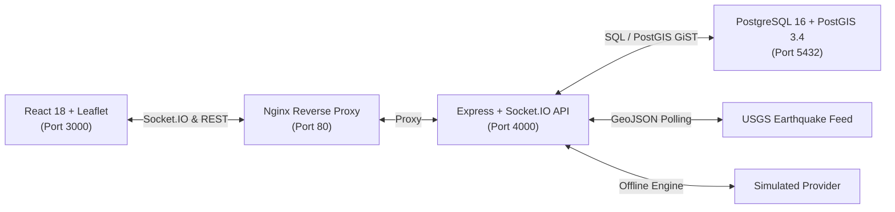

# ResQGrid — Real-Time Disaster Alert and Response Platform

[]()
[]()
[]()
[]()

> **Final-Year B.Tech CSE Project**  
> **Institution:** SRM Institute of Science and Technology, Kattankulathur  
> **Evaluation Focus:** DevOps, Cloud Infrastructure, CI/CD, Containerization, Monitoring & Observability, Autoscaling, Blue-Green Deployment  
> **Milestone:** Phase 1 — Application Foundation  

---

## 1. Project Overview

**ResQGrid** is a real-time, geofenced disaster alerting and incident response platform designed to bridge the gap between regional emergency detection and localized warning delivery.

During civil emergencies (floods, earthquakes, severe storms, hazmat incidents), every second matters. ResQGrid combines native spatial geometry indexing (**PostgreSQL + PostGIS**) and bi-directional real-time communication (**Socket.IO**) to compute which connected citizens and emergency responders fall within a hazard's notification perimeter.

### Key Capabilities in Phase 1:
- **Interactive Geospatial Dashboard:** OpenStreetMap with Leaflet showing dynamic incident clusters, severity codes, and personal user location.
- **Privacy-Preserving Geofencing:** Client GPS location is only requested upon explicit user opt-in, stays in the client session, and is never broadcast to other users.
- **Provider Abstraction Architecture:** Ingests live USGS earthquake feeds, severe weather observations, and offline simulated drill scenarios with strict visual labeling.
- **Live WebSocket Alert Delivery:** Server-side spatial filtering broadcasts high-priority emergency banners to clients within the impact zone without page refresh.
- **Role-Based Incident Response:** Secure JWT authentication with role authorization (`admin`, `responder`, `viewer`) for incident reporting and status management.
- **DevOps & Observability Ready:** Built-in `/health/live`, `/health/ready`, and Prometheus `/metrics` instrumentation.

---

## 2. Technology Stack

| Layer | Technologies |
|---|---|
| **Frontend** | React 18, Vite, TypeScript, Tailwind CSS, Lucide Icons |
| **Mapping Engine** | Leaflet with OpenStreetMap cartography |
| **Backend API** | Node.js (ESM), Express, TypeScript, Zod, Pino |
| **Real-Time Engine** | Socket.IO (WebSockets with polling fallback) |
| **Spatial Database** | PostgreSQL 16 + PostGIS 3.4 (WGS 84 / SRID 4326) |
| **Testing** | Vitest, Supertest, React Testing Library, jsdom |
| **Containerization** | Docker (Multi-stage non-root) and Docker Compose |

---

## 3. High-Level Architecture



---

## 4. Quick Start Guide

### Prerequisites
- **Node.js**: v20 or v22 LTS (`node -v`)
- **npm**: v10+ (`npm -v`)
- **Docker & Docker Compose** (for containerized database/application)
- **Git**

### Installation

1. **Clone repository and configure environment:**
   ```bash
   git clone <repo_url>
   cd Devops_project
   cp .env.example .env
   ```

2. **Install all dependencies across monorepo workspaces:**
   ```bash
   npm install
   ```

3. **Start PostgreSQL with PostGIS:**
   - Option A (Docker):
     ```bash
     docker compose up -d db
     ```
   - Option B (Local PostgreSQL): Ensure PostGIS extension is installed and update credentials in `.env`.

4. **Run Database Migrations and Seed Data:**
   ```bash
   npm --workspace=backend run migrate
   npm --workspace=backend run seed
   ```

5. **Start Development Servers:**
   ```bash
   # Terminal 1: Backend API & WebSocket Server (Port 4000)
   npm run dev:backend

   # Terminal 2: Frontend Dashboard (Port 3000)
   npm run dev:frontend
   ```

6. Open [http://localhost:3000](http://localhost:3000) in your browser.

---

## 5. Running with Docker Compose (Production Setup)

ResQGrid provides a production-grade multi-stage container configuration:

```bash
# Build and run the entire stack (PostGIS + Backend + Frontend/Nginx)
docker compose up --build -d

# Verify container health
docker compose ps

# View live application logs
docker compose logs -f
```

Access Points:
- **Frontend Dashboard:** [http://localhost:3000](http://localhost:3000)
- **Backend API:** [http://localhost:4000](http://localhost:4000)
- **Liveness Probe:** [http://localhost:4000/health/live](http://localhost:4000/health/live)
- **Readiness Probe:** [http://localhost:4000/health/ready](http://localhost:4000/health/ready)
- **Prometheus Metrics:** [http://localhost:4000/metrics](http://localhost:4000/metrics)

---

## 6. Pre-configured Evaluation Credentials

| Role | Email | Password | Permissions |
|---|---|---|---|
| **System Admin** | `admin@resqgrid.local` | `Admin123!` | Create incidents, update status, dispatch simulation drills, trigger provider ingestion |
| **Emergency Responder** | `responder@resqgrid.local` | `Responder123!` | Create incidents, update status |
| **Citizen Viewer** | `citizen@resqgrid.local` | `Citizen123!` | View incident dashboard, receive geofenced proximity alerts |

---

## 7. Automated Testing & Quality Checks

Run the automated test suite verifying spatial matching, validation, providers, REST endpoints, and UI components:

```bash
# Run all 81 tests across all workspaces
npm run test

# Run backend tests only (59 tests)
npm run test:backend

# Run frontend tests only (22 tests)
npm run test:frontend

# Run TypeScript typechecks
npm run lint

# Compile production builds
npm run build
```

---

## 8. Troubleshooting

| Issue | Cause | Solution |
|---|---|---|
| `Connection refused: postgres:5432` | Database container is not running | Run `docker compose up -d db` and wait for healthcheck to pass |
| `PostGIS extension not found` | Standard Postgres image used without PostGIS | Ensure image is `postgis/postgis:16-3.4-alpine` |
| `Location permission denied` | Browser blocked geolocation access | Click padlock icon in browser address bar, allow Location, and click "Enable My Location" |
| `Socket offline / disconnected` | Backend is not reachable | Ensure backend is listening on port 4000 and `VITE_SOCKET_URL` is set |

---

## 9. Documentation Directory

- [Architecture & Data Flow](docs/architecture.md) — Architectural diagrams, components, and data flow.
- [API Reference](docs/api.md) — Comprehensive REST API endpoints and Socket.IO events.
- [Testing Guide](docs/testing.md) — Test suites, coverage, and execution instructions.
- [Phase 1 Completion Report](docs/phase-1-completion.md) — Feature checklist, verification log, and roadmap to Phase 2.
