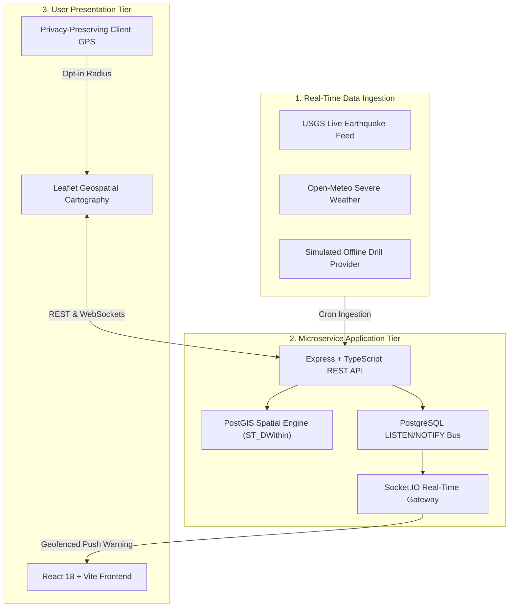
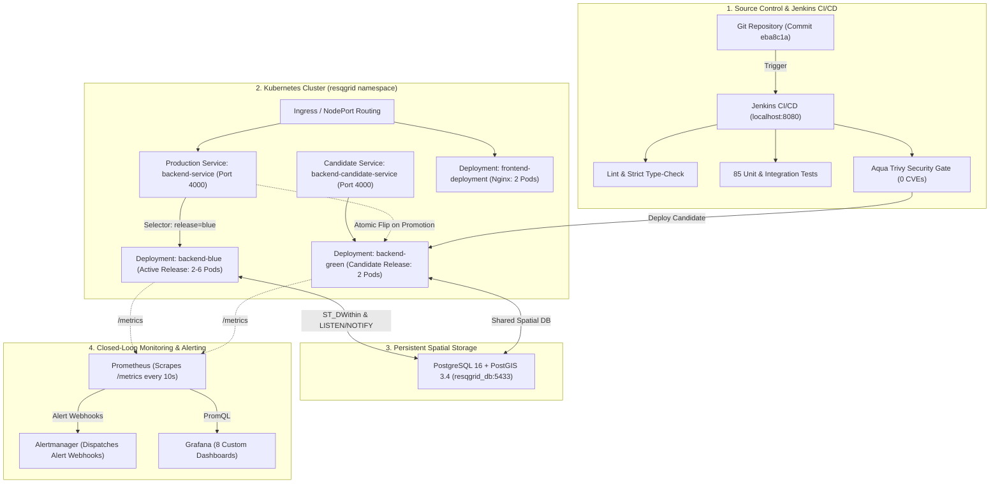

# ResQGrid — Real-Time Disaster Alert and Response Platform

[]()
[]()
[]()
[]()
[]()
[]()

> **Final-Year B.Tech CSE Capstone Project**  
> **Institution:** SRM Institute of Science and Technology, Kattankulathur  
> **Evaluation Scope:** DevOps, Cloud Architecture, Jenkins CI/CD, Container Security, Kubernetes Orchestration, Horizontal Pod Autoscaling (HPA), Prometheus & Alertmanager Observability, Zero-Downtime Blue-Green Releases & Automated Rollback  
> **Verification Status:** **100% OPERATIONAL, AUDITED & DEFENSE READY**

---

## 1. Project Overview

**ResQGrid** is a mission-critical, geofenced disaster alerting and incident response platform designed to bridge the gap between regional emergency detection and immediate, localized alert delivery to affected citizens and emergency responders.

During natural disasters (floods, earthquakes, severe storms) and industrial hazards, conventional mass broadcasts fail to account for geographic boundaries. ResQGrid combines spatial indexing (**PostgreSQL + PostGIS**) and low-latency bidirectional communication (**Socket.IO**) to compute which connected clients fall within a hazard's dynamic impact zone in real time.



---

## 2. Comprehensive Technology Stack

| Layer / Domain | Technologies & Frameworks | Version / Specifications | Role in ResQGrid |
|---|---|---|---|
| **Frontend UI** | React 18, Vite 6, TypeScript, Tailwind CSS, Lucide Icons | React 18.3 / Vite 6.4 | Responsive emergency response portal with live event feed |
| **GIS Mapping** | Leaflet Cartography with OpenStreetMap tiles | Leaflet 1.9 | Real-time map rendering dynamic incident polygons and severity rings |
| **Backend API** | Node.js (ESM), Express, TypeScript 5, Zod, Pino | Node 20+ / TS 5.6 | Strict schema validation, REST endpoints, and health probes |
| **Spatial Database** | PostgreSQL 16 + PostGIS 3.4 (WGS 84 / SRID 4326) | PG 16.0 / PostGIS 3.4.3 | GiST spatial indexing with native `ST_DWithin` geofencing queries |
| **Real-Time Bus** | Socket.IO 4.8 + Native Postgres `LISTEN/NOTIFY` | Socket.IO v4.8 | Cross-pod horizontal event distribution without external Redis overhead |
| **Automated Testing**| Vitest, Supertest, React Testing Library, jsdom | Vitest 2.1 | **85 automated tests** (62 backend + 23 frontend) |
| **Container Engine** | Multi-stage Docker with non-root runtime (UID 10001) | Docker 25+ / containerd 2.3 | Hardened production container images |
| **CI/CD Pipeline** | Jenkins Declarative Pipeline (16 Stages) | Jenkins 2.568.3 | SCM checkout, linting, tests, Trivy gates, and deployment automation |
| **Security Gates** | Aqua Trivy Vulnerability Scanner, SonarQube, OWASP | Trivy 0.76.0 | Enforces 0 HIGH/CRITICAL CVEs before release promotion |
| **Kubernetes** | Docker Desktop Kubernetes / Rancher k3s | Kubernetes v1.36.1 | Dual Blue-Green deployments, Services, ConfigMaps, and Secrets |
| **Autoscaling** | Kubernetes HPA (`autoscaling/v2`) + Metrics-Server | v1beta1 API | Dynamic pod scaling (2 to 6 replicas) based on CPU (60%) & Memory (70%) |
| **Observability** | Prometheus, Alertmanager, Grafana | Prom 2.50 / AM 0.27 / Graf 10.3 | Metric scraping, automated alert routing, and 8 custom Grafana panels |
| **Load Testing** | Grafana k6 Load Testing Engine | k6 v2.2+ / v0.50 | Pre-promotion smoke tests, baseline benchmarks, and HPA stress triggers |

---

## 3. High-Level DevOps & Release Architecture



---

## 4. Evaluation Portals & Credentials

> [!IMPORTANT]
> The credentials below are **local evaluation placeholders** pre-seeded for academic demonstration on `localhost` only. No real or production credentials are stored in this repository. In production, credentials must be dynamically provisioned via AWS Secrets Manager or HashiCorp Vault.

| Portal | URL | Default Local Credentials | Description |
|---|---|---|---|
| **Frontend Portal** | [http://localhost:3080](http://localhost:3080) | *Public access (no login required)* | Production React UI served by in-cluster Nginx |
| **Backend Health** | [http://localhost:4080/health/ready](http://localhost:4080/health/ready) | N/A | Readiness probe; returns HTTP 200, release color, DB latency |
| **Jenkins CI/CD** | [http://localhost:8080](http://localhost:8080) | `admin` / `<LOCAL_ADMIN_PASS>` *(default: admin)* | Shows verified pipeline `resqgrid-local-verification` |
| **Grafana Monitoring**| [http://localhost:3001](http://localhost:3001) | `admin` / `<LOCAL_GRAFANA_PASS>` *(default: admin)* | Real-time PromQL dashboard (*ResQGrid Platform Overview*) |
| **Prometheus Server** | [http://localhost:9090](http://localhost:9090) | N/A | Active scrape targets, PromQL metrics console, alert rules |
| **Alertmanager UI** | [http://localhost:9093](http://localhost:9093) | N/A | In-cluster alert notification routing and silence console |

### Pre-Configured Local Development Roles (Database Seeded)
| Role | Email | Local Seed Password Placeholder | Permissions |
|---|---|---|---|
| **System Admin** | `admin@resqgrid.local` | `<LOCAL_ADMIN_PASS>` *(seed: Admin123!)* | Create incidents, update status, dispatch simulation drills, trigger ingestion |
| **Emergency Responder** | `responder@resqgrid.local` | `<LOCAL_RESPONDER_PASS>` *(seed: Responder123!)* | Create incidents, patch status, view operational reports |
| **Citizen Viewer** | `citizen@resqgrid.local` | `<LOCAL_CITIZEN_PASS>` *(seed: Citizen123!)* | View incident map, receive geofenced proximity alerts |

---

## 5. Quick Start & Local Execution Guide

### Prerequisites
- Windows 11 with PowerShell 5.1+ and WSL2 Ubuntu
- Docker Desktop with **Kubernetes enabled** (`v1.36+`)
- Node.js `v20+` and npm `v9+`
- Aqua Trivy (`0.76+`) and Grafana k6 (`0.50+`)

### Step 1: Clone and Install Dependencies
```bash
git clone https://github.com/RichieRichard0000/Devops_project.git
cd Devops_project
npm ci
```

### Step 2: Run Full Automated Verification Suite
```bash
# 1. Run all 85 unit and integration tests (62 backend + 23 frontend)
npm run test

# 2. Strict static TypeScript compilation check
npm run lint

# 3. Production Vite and TypeScript bundle build
npm run build
```

### Step 3: Start the Spatial Database Container
```bash
# Start PostgreSQL 16 + PostGIS on host port 5433
docker compose up -d resqgrid_db
```

### Step 4: Deploy Full Kubernetes Stack (Kustomize)
```bash
# Deploys namespace, configs, secrets, blue/green deployments, services, HPA, Prometheus, Grafana, Alertmanager
kubectl apply -k infra/k8s
```

### Step 5: Start Local Port-Forwards
```powershell
# In separate background terminals or PowerShell sessions:
kubectl port-forward svc/frontend-service 3080:80 -n resqgrid
kubectl port-forward svc/backend-service 4080:4000 -n resqgrid
kubectl port-forward svc/grafana 3001:3000 -n resqgrid
kubectl port-forward svc/prometheus 9090:9090 -n resqgrid
kubectl port-forward svc/alertmanager 9093:9093 -n resqgrid
```

---

## 6. Blue-Green Deployment & Rollback Execution

### Promote Candidate Release to Production
```powershell
# Atomically route production traffic to candidate-green:
kubectl patch service backend-service -n resqgrid -p '{"spec":{"selector":{"release":"green"}}}'

# Verify active release header is green:
curl.exe -s -i http://localhost:4080/health/live | Select-String "X-Release"
```

### Execute Emergency Instant Rollback (<200 ms)
```powershell
# Runs automated rollback engine to restore previous stable color:
.\infra\k8s\rollback.ps1
```

### Demonstrate HPA Dynamic Autoscaling Under Load
```powershell
# Subject the cluster to a 40-VU load test:
k6 run --vus 40 --duration 30s infra/load-tests/smoke-test.js

# Observe pods dynamically scale from 2 to 4 to 6 replicas:
kubectl get hpa -n resqgrid -w
```

---

## 7. Master Documentation Directory

- [Final Demonstration Readiness Report](docs/final-demonstration-report.md) — Comprehensive empirical verification record and claim-versus-evidence matrix.
- [Academic Viva & Defense Guide](docs/academic-viva-guide.md) — 15 top technical viva questions with architectural answers.
- [Live Demonstration Runbook](docs/demo-runbook.md) — Chronological 5–8 minute presentation sequence.
- [DevOps Architecture & Flow](docs/devops-architecture.md) — Complete component responsibilities and system interactions.
- [CI/CD Pipeline Guide](docs/ci-cd-pipeline.md) — 16-stage Jenkins pipeline, SonarQube, and OWASP thresholds.
- [Monitoring & Alerting Guide](docs/monitoring.md) — Prometheus metrics, Alertmanager lifecycle, and Grafana panels.
- [Autoscaling & SRE Runbook](docs/autoscaling.md) — HPA mathematical model, resource quotas, and k6 drills.
- [Blue-Green Deployment Guide](docs/blue-green-deployment.md) — Zero-downtime release mechanics and pre-promotion smoke testing.
- [Emergency Rollback Runbook](docs/rollback-runbook.md) — Sub-second traffic restoration and failure recovery procedures.
- [Security & Vulnerability Policy](docs/security-policy.md) — Trivy container gates, non-root contexts, and secret handling.
- [Cloud FinOps & Cost Model](docs/cost-management.md) — AWS VPC topology ($36.92/mo) and managed EKS cost comparison.
- [REST API & Socket.IO Reference](docs/api.md) — API schemas, query parameters, and WebSocket event catalogue.

---

## 8. License & Academic Attribution
Developed as a Final-Year B.Tech Computer Science and Engineering Capstone Project at **SRM Institute of Science and Technology, Kattankulathur**. Code licensed under the [MIT License](LICENSE).
