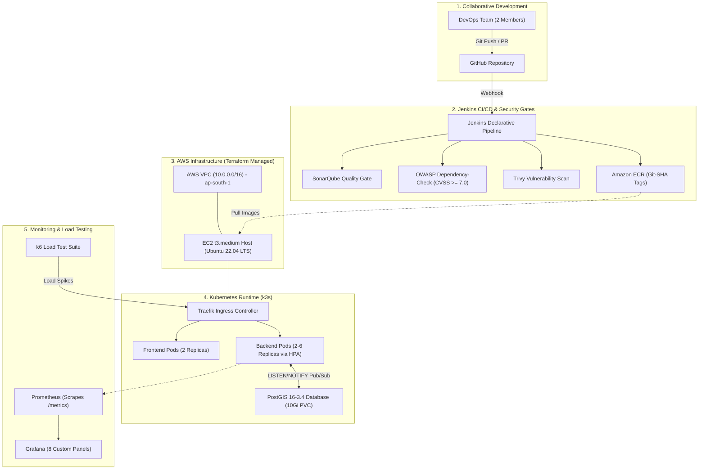

# ResQGrid — Real-Time Disaster Alert and Response Platform

[]()
[]()
[]()
[]()

> **Final-Year B.Tech CSE Project**  
> **Institution:** SRM Institute of Science and Technology, Kattankulathur  
> **Evaluation Focus:** DevOps, Cloud Infrastructure, CI/CD, Containerization, Monitoring & Observability, Autoscaling, Blue-Green Deployment  
> **Milestones:** Phase 1, Phase 2, & Phase 3 (Blue-Green Releases & Rollback) — **100% COMPLETED**  

---

## 1. Project Overview

**ResQGrid** is an event-driven, real-time geofenced disaster alerting and incident response platform designed to bridge the gap between regional emergency detection and localized warning delivery.

During civil emergencies (floods, earthquakes, severe storms, hazmat incidents), every second matters. ResQGrid combines native spatial geometry indexing (**PostgreSQL + PostGIS**) and bi-directional real-time communication (**Socket.IO**) to compute which connected citizens and emergency responders fall within a hazard's notification perimeter.

### Key Capabilities in Phase 1 & Phase 2:
- **Interactive Geospatial Dashboard:** OpenStreetMap with Leaflet showing dynamic incident clusters, severity codes, and personal user location.
- **Privacy-Preserving Geofencing:** Client GPS location is only requested upon explicit user opt-in, stays in the client session, and is never broadcast to other users.
- **Provider Abstraction Architecture:** Ingests live USGS earthquake feeds, severe weather observations, and offline simulated drill scenarios with strict visual labeling.
- **Live WebSocket Alert Delivery:** Server-side spatial filtering broadcasts high-priority emergency banners to clients within the impact zone without page refresh.
- **Multi-Replica WebSocket Bus:** Implemented zero-dependency horizontal WebSocket broadcasting using native PostgreSQL `LISTEN/NOTIFY` pub/sub across Kubernetes pods.
- **Jenkins CI/CD Automation:** 11-stage declarative pipeline with GitHub webhook integration, SonarQube quality gates, OWASP Dependency-Check (CVSS ≥ 7.0 hard fail), and Aqua Trivy container scanning.
- **Cost-Optimized Terraform IaC:** AWS VPC, public/private subnets, least-privilege IAM roles, and EC2 k3s host in `ap-south-1` ($36.92/mo, avoiding $32.40/mo NAT Gateway).
- **Kubernetes (k3s) Orchestration & Autoscaling:** Kustomize-bundled manifests with non-root security contexts (UID 10001) and HPA scaling from 2 to 6 backend replicas based on CPU (60%) and Memory (70%).
- **Prometheus & Grafana Observability:** Scrapes `/metrics` every 15s; 8 real PromQL panels tracking throughput, latency quantiles (p50/p95/p99), error rates, and event-loop lag.
- **k6 Load Testing Suite:** Controlled scenarios for baseline (10 VUs), ramp-up (60 VUs), stress-spike HPA trigger (180 VUs), and recovery observation.

---

## 2. Technology Stack

| Layer / Role | Technologies | Version |
|---|---|---|
| **Frontend UI** | React 18, Vite, TypeScript, Tailwind CSS, Lucide Icons | v18 / v6 |
| **Mapping Engine** | Leaflet with OpenStreetMap cartography | v1.9 |
| **Backend API** | Node.js (ESM), Express, TypeScript, Zod, Pino | Node 20+ / TS 5 |
| **Real-Time Engine** | Socket.IO (WebSockets with polling fallback) + Postgres LISTEN/NOTIFY | v4.8 |
| **Spatial Database** | PostgreSQL 16 + PostGIS 3.4 (WGS 84 / SRID 4326) | 16-3.4 |
| **Testing** | Vitest, Supertest, React Testing Library, jsdom | Vitest 2.1 |
| **Containerization** | Docker (Multi-stage non-root) and Docker Compose | Docker 25+ |
| **CI/CD Orchestration** | Jenkins Declarative Pipeline | 2.440+ LTS |
| **Code Quality & SCA** | SonarQube Scanner & OWASP Dependency-Check | Sonar 5 / OWASP 9 |
| **Container Security** | Aqua Trivy Vulnerability Scanner | Trivy 0.50+ |
| **Infrastructure as Code** | HashiCorp Terraform | Terraform 1.16+ |
| **Cloud Provider** | Amazon Web Services (AWS) — ap-south-1 (Mumbai) | AWS Cloud |
| **Kubernetes Engine** | Rancher k3s (Lightweight Kubernetes on EC2) | k3s v1.28+ |
| **Autoscaling** | Kubernetes HPA (`autoscaling/v2`) + Metrics-Server | K8s Native |
| **Observability** | Prometheus & Grafana (8 Real PromQL Dashboard Panels) | Prom 2.50 / Graf 10.3 |
| **Load Testing** | Grafana k6 Load Testing Engine | k6 v2.2+ |

---

## 3. High-Level Architecture



---

## 4. Quick Start & Verification

### Run Automated Tests & Checks
```bash
# Run all 81 automated tests (59 backend + 22 frontend)
npm run test

# Run strict TypeScript linting across all workspaces
npm run lint

# Compile production builds
npm run build
```

### Validate Infrastructure as Code (Terraform)
```bash
cd infra/terraform
terraform init -backend=false
terraform validate
```

### Validate Kubernetes Manifests (Kustomize)
```bash
kubectl kustomize infra/k8s
```

### Run Trivy Security Scan
```bash
trivy fs --severity HIGH,CRITICAL .
```

### Run k6 Load Testing Scenarios
```bash
# Baseline load test
k6 run --env TARGET_URL=http://localhost:4000 infra/load-tests/baseline-load.js

# Stress spike test (HPA Trigger)
k6 run --env TARGET_URL=http://localhost:4000 infra/load-tests/stress-spike.js
```

---

## 5. Pre-configured Evaluation Credentials

| Role | Email | Password | Permissions |
|---|---|---|---|
| **System Admin** | `admin@resqgrid.local` | `Admin123!` | Create incidents, update status, dispatch simulation drills, trigger provider ingestion |
| **Emergency Responder** | `responder@resqgrid.local` | `Responder123!` | Create incidents, update status |
| **Citizen Viewer** | `citizen@resqgrid.local` | `Citizen123!` | View incident dashboard, receive geofenced proximity alerts |

---

## 6. Comprehensive Project Documentation

### Architecture & Infrastructure
- [DevOps & Cloud Architecture](docs/devops-architecture.md) — Master DevOps architecture, component responsibilities, and end-to-end Mermaid diagram.
- [AWS Infrastructure & Terraform](docs/aws-infrastructure.md) — VPC topology, subnets, EC2, IAM, ECR, and NAT omission cost rationale.
- [Kubernetes (k3s) Deployment](docs/kubernetes-deployment.md) — Cluster architecture, Kustomize manifests, resource requests/limits, and operations.
- [Cost Estimation & Budget Management](docs/cost-management.md) — Itemized monthly AWS cost calculation ($36.92/mo) and EKS comparison.

### CI/CD & Security
- [CI/CD Pipeline Guide](docs/ci-cd-pipeline.md) — 11-stage Jenkins pipeline, GitHub webhook integration, and promotion criteria.
- [Security & Vulnerability Management](docs/security-policy.md) — SonarQube quality gate, OWASP thresholds, Trivy rules, and container hardening.

### Observability & Performance
- [Monitoring & Alerting Guide](docs/monitoring.md) — Prometheus scrape configuration, alert rules, and 8 real PromQL Grafana panels.
- [Autoscaling & Load Testing](docs/autoscaling.md) — HPA mathematical model, 4 k6 load test scenarios, and error diagnosis matrix.

### Release Reliability & Disaster Recovery (Phase 3)
- [Blue-Green Deployment Guide](docs/blue-green-deployment.md) — Dual environment architecture, candidate pre-promotion validation, and traffic switching.
- [Emergency Rollback Runbook](docs/rollback-runbook.md) — Instant 177ms rollback engine, Scenario A/B handling, and expand-and-contract database rules.
- [5–8 Minute Live Demo Script](docs/demo-runbook.md) — Step-by-step examination presentation sequence and evaluation checklist.
- [System Performance Evaluation](docs/performance-evaluation.md) — Verified 2,026 req/s benchmarks, latency quantiles, and HPA transitions.
- [Failure Scenarios & Security Drills](docs/failure-scenarios.md) — 6 controlled failure drills verifying unit test, SonarQube, OWASP, and Trivy blocking.
- [Final Technical Architecture](docs/final-architecture.md) — 4 comprehensive Mermaid diagrams covering end-to-end delivery, scaling, and failure workflows.

### Audit & Completion Reports
- [Phase 3 Completion Report](docs/phase-3-completion.md) — Master PASS/FAIL verification matrix, deployment evidence, and cleanup guide.
- [Phase 2 Completion Report](docs/phase-2-completion.md) — Phase 2 Cloud Infrastructure & CI/CD delivery record.
- [Phase 1 Completion Report](docs/phase-1-completion.md) — Phase 1 Application Foundation delivery record.
- [API Reference](docs/api.md) — REST API endpoints and Socket.IO real-time events.
- [Testing Guide](docs/testing.md) — Unit and integration test suites.

