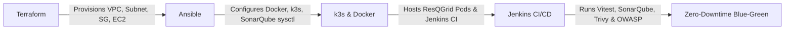

# Ansible Configuration Management & SonarQube Integration — ResQGrid

This directory contains the automated server configuration management, SonarQube environment preparation, and cluster audit suite for the **ResQGrid** disaster alert and response platform.

---

## 1. Architectural Shift: From Cloud-Init to Pure Ansible

In early iterations, the server was bootstrapped using cloud-init (`user_data` in Terraform). We refactored this to achieve strict enterprise separation of concerns:

- **Terraform (Day-0 Infrastructure):** Exclusively provisions cloud resources (AWS VPC, Subnets, Internet Gateway, Security Groups, EC2 instance). Cloud-init `user_data` has been completely stripped from `infra/terraform/compute.tf`.
- **Ansible (Day-1 & Day-2 Operations):** Connects to the bare EC2 host over AWS SSM Session Manager and idempotently provisions the environment (Docker, k3s, SonarQube requirements, and security baselines).

---

## 2. Directory & Role Architecture

```
ansible/
├── ansible.cfg                # Global Ansible configuration (SSH over AWS SSM, pipelining)
├── group_vars/
│   └── all.yml                # Environment variables, package lists, service states
├── inventory/
│   └── hosts.ini              # Managed hosts definition using SSH alias 'resqgrid-dev'
├── playbooks/
│   ├── site.yml               # Master orchestration entrypoint
│   └── server_setup.yml       # Server configuration, SonarQube, and audit playbook
├── roles/
│   ├── common/                # Role: Baseline system utilities, OS assertions, workspace
│   ├── docker/                # Role: Docker engine status and container verification
│   ├── sonarqube/             # Role: SonarQube kernel tuning (vm.max_map_count) & config
│   └── verification/          # Role: k3s status, pod health, disk/memory assertions
└── README.md                  # Comprehensive viva guide & documentation
```

---

## 3. SonarQube Static Application Security Testing (SAST)

SonarQube provides continuous inspection of code quality, detecting bugs, security vulnerabilities, and code smells.

### A. Kernel Tuning (`roles/sonarqube`)
SonarQube's embedded search engine requires `vm.max_map_count >= 262144`. Ansible automatically configures and persists this parameter:
```yaml
- name: "[SonarQube] Ensure vm.max_map_count is configured"
  ansible.builtin.lineinfile:
    path: /etc/sysctl.conf
    line: "vm.max_map_count=262144"
```

### B. Project Configuration (`sonar-project.properties`)
- **Key:** `resqgrid`
- **Sources Analyzed:** `backend/src`, `frontend/src`
- **Unit Test Execution Reports:** `backend/junit.xml`, `frontend/junit.xml` (from 110 Vitest tests)
- **Quality Gate:** Enforces zero critical bugs and high security/reliability ratings before builds pass.

### C. Execution Script
Executed via `scripts/run-sonarqube-analysis.sh` or within the Jenkins pipeline.

---

## 4. Execution & Verification Runbook

All commands are executed from the `ansible/` root directory:

```bash
cd /mnt/c/Users/baran/Downloads/Devops_project/ansible
export ANSIBLE_CONFIG=ansible.cfg

# 1. Validate Playbook Syntax
ansible-playbook -i inventory/hosts.ini playbooks/site.yml --syntax-check

# 2. Test Host Connectivity (Ad-hoc Ping)
ansible -i inventory/hosts.ini all -m ping

# 3. Dry-Run / Check Mode
ansible-playbook -i inventory/hosts.ini playbooks/site.yml --check

# 4. Execute Full Playbook
ansible-playbook -i inventory/hosts.ini playbooks/site.yml
```

---

## 5. Viva Demonstration Sequence



1. **Terraform (Day 0):** Pure cloud IaC with zero embedded bash user-data.
2. **Ansible (Day 1 / Day 2):** Idempotent configuration management over zero-trust AWS SSM.
3. **SonarQube + Vitest + Trivy + OWASP:** Complete 4-tier security & quality gate.
4. **Kubernetes (k3s):** Orchestrates ResQGrid microservices, PostgreSQL, Prometheus, Grafana, and Alertmanager.
