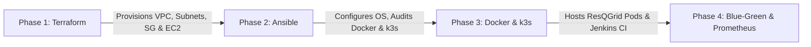

# Ansible Configuration Management — ResQGrid Platform

This directory contains the automated server configuration management and verification suite for the **ResQGrid** disaster alert and response platform.

---

## 1. What is Ansible?

**Ansible** is an open-source, agentless IT automation and configuration management tool. It communicates with managed nodes over standard SSH (or WinRM on Windows) and executes tasks via small Python modules transferred temporarily to the target host. Because it requires no background agent daemon (unlike Chef, Puppet, or SaltStack), it minimizes resource overhead on managed instances and avoids version mismatch issues.

---

## 2. Why We Introduced Ansible in ResQGrid

In earlier phases of ResQGrid, the baseline EC2 instance was initially bootstrapped using an EC2 `user_data` shell script in Terraform (`infra/terraform/compute.tf`). While cloud-init user-data works well for one-time initialization, it suffers from significant limitations:
- **No Idempotency Feedback:** Shell scripts do not naturally report what was changed vs. what was already compliant.
- **No State Verification:** If a package fails or a service degrades later, user-data does not run again automatically to reconcile drift.
- **Difficult to Maintain:** Monolithic shell scripts become brittle as requirements grow.

We introduced **Ansible** to:
1. Standardize and automate ongoing operating system configuration.
2. Audit and enforce system invariants (required packages, directory ownership, Docker and k3s daemon state).
3. Validate node health, disk headroom, and memory availability without restarting live services.
4. Provide a structured, role-based configuration framework suitable for academic evaluation and production operations.

> **Important Viva Note:** We did not use Ansible for the initial day-0 server provisioning. Terraform provisioned the AWS VPC, subnets, and EC2 instance. We introduced Ansible to manage, audit, and standardize the server configuration post-provisioning.

---

## 3. Terraform versus Ansible

A common viva examination question is the distinction between Terraform and Ansible:

| Feature | Terraform | Ansible |
| :--- | :--- | :--- |
| **Primary Domain** | Infrastructure as Code (IaC) | Configuration Management (CM) & Application Deployment |
| **Focus** | *What* resources exist (VPC, Subnets, EC2, IAM, ECR) | *How* the OS and runtime environment inside EC2 are configured |
| **State Paradigm** | Declarative state file (`terraform.tfstate`) | Declarative task execution with idempotent convergence |
| **Agent / Protocol** | AWS APIs / Cloud Provider SDKs | Agentless SSH / SFTP / Python runtime |
| **Lifecycle Role** | Day-0 provisioning & hardware lifecycle | Day-1 configuration, Day-2 maintenance & compliance auditing |

---

## 4. Control Node and Managed Node Architecture

```
+-------------------------------------------------------------+
|                     CONTROL NODE                            |
|  Local Workstation (WSL Ubuntu 22.04 / Linux)               |
|  - Ansible Core 2.20.1                                      |
|  - AWS CLI v2 + Session Manager Plugin                      |
|  - SSH Client (~/.ssh/config alias 'resqgrid-dev')          |
+------------------------------+------------------------------+
                               |
                               | SSH over AWS Systems Manager
                               | (Zero-Trust, Port 22 closed to WAN)
                               v
+-------------------------------------------------------------+
|                     MANAGED NODE                            |
|  AWS EC2 Instance (c7i-flex.large, Ubuntu 22.04 LTS)        |
|  - Python 3.10 interpreter                                  |
|  - Docker 29.9.3 (resqgrid-jenkins)                         |
|  - k3s Lightweight Kubernetes (v1.37.2+k3s1)                |
|  - ResQGrid Workloads (backend, frontend, postgres, mon)    |
+-------------------------------------------------------------+
```

- **Control Node:** The workstation or CI runner where Ansible is installed. For Windows hosts, this runs inside WSL (Windows Subsystem for Linux) or a Linux control host.
- **Managed Node:** The target server (`resqgrid-dev`, AWS EC2 instance `i-09a59b14bedee2307`). No Ansible software is installed on the managed node; Ansible only requires Python 3.8+ on the remote system.

---

## 5. Directory & Role Structure

```
ansible/
├── ansible.cfg                # Global Ansible configuration (inventory, paths, ssh pipelining)
├── group_vars/
│   └── all.yml                # Environment variables, package lists, service names
├── inventory/
│   └── hosts.ini              # Managed hosts definition using SSH alias 'resqgrid-dev'
├── playbooks/
│   ├── site.yml               # Master orchestration entrypoint
│   └── server_setup.yml       # Server configuration and audit playbook
├── roles/
│   ├── common/                # Role: Baseline utilities, OS checks, workspace directory
│   │   ├── defaults/main.yml
│   │   ├── handlers/main.yml
│   │   └── tasks/main.yml
│   ├── docker/                # Role: Docker engine status and container verification
│   │   ├── defaults/main.yml
│   │   ├── handlers/main.yml
│   │   └── tasks/main.yml
│   └── verification/          # Role: k3s status, pod health, disk/memory assertions
│       └── tasks/main.yml
└── README.md                  # Comprehensive viva guide & documentation
```

---

## 6. Key Concepts Demonstrated

### 6.1 Idempotency
An operation is **idempotent** if applying it multiple times produces the exact same result without unintended side effects.
- **Run 1:** Applied 2 configuration updates (`changed=2`: refreshed package index cache, ensured directory permissions).
- **Run 2:** Verified that every state requirement was already satisfied (`changed=0`, `ok=22`, `failed=0`).
- No running services (Docker, Jenkins, k3s, PostgreSQL) were restarted or disrupted during either run.

### 6.2 Privilege Escalation (`become`)
Privilege escalation is applied selectively:
- Read-only queries (`which docker`, `kubectl get pods`, checking workspace) run as unprivileged user `ubuntu` (`become: false`).
- System-level tasks (`apt`, `service` status enforcement) escalate to root via `become: true` (`become_method: sudo`).
- No passwords or tokens are stored in plain text.

### 6.3 Secure SSH via AWS Systems Manager
Management access avoids open internet ports:
- The EC2 security group allows **no inbound SSH (port 22) from the public internet**.
- The control node connects via an SSH ProxyCommand:
  ```ssh
  ProxyCommand aws --profile AdministratorAccess-016626013328 ssm start-session \
      --target %h --document-name AWS-StartSSHSession --parameters "portNumber=%p" --region ap-south-1
  ```
- SSH host-key verification remains active (`host_key_checking = True`), satisfying zero-trust security standards.

---

## 7. Prerequisites & Control Node Setup

### Windows Control Node via WSL Ubuntu

1. **Enable WSL 2 and install Ubuntu:**
   ```powershell
   wsl --install -d Ubuntu
   ```

2. **Install Ansible and AWS CLI inside WSL:**
   ```bash
   sudo apt-get update && sudo apt-get install -y ansible python3-pip
   # Install AWS CLI v2 and Session Manager plugin
   ```

3. **Configure SSH in `~/.ssh/config` inside WSL:**
   ```ssh
   Host resqgrid-dev
       HostName i-09a59b14bedee2307
       User ubuntu
       ProxyCommand aws --profile AdministratorAccess-016626013328 ssm start-session --target %h --document-name AWS-StartSSHSession --parameters "portNumber=%p" --region ap-south-1
       IdentityFile ~/.ssh/resqgrid-key.pem
       StrictHostKeyChecking accept-new
   ```

4. **Authenticate AWS SSO:**
   ```bash
   aws sso login --profile AdministratorAccess-016626013328
   ```

---

## 8. Execution & Verification Runbook

All commands are executed from the `ansible/` root directory:

```bash
cd /mnt/c/Users/baran/Downloads/Devops_project/ansible
export ANSIBLE_CONFIG=ansible.cfg
```

### Step 1: Validate Playbook Syntax
```bash
ansible-playbook -i inventory/hosts.ini playbooks/site.yml --syntax-check
```
*Expected Output:*
```
playbook: playbooks/site.yml
```

### Step 2: Test Host Connectivity (Ad-hoc Ping)
```bash
ansible -i inventory/hosts.ini all -m ping
```
*Expected Output:*
```json
resqgrid-dev | SUCCESS => {
    "changed": false,
    "ping": "pong"
}
```

### Step 3: Check Mode (Dry Run)
```bash
ansible-playbook -i inventory/hosts.ini playbooks/site.yml --check
```

### Step 4: Execute Playbook (Run 1)
```bash
ansible-playbook -i inventory/hosts.ini playbooks/site.yml
```
*Actual Measured Result:*
```
PLAY RECAP *********************************************************************
resqgrid-dev               : ok=22   changed=2    unreachable=0    failed=0    skipped=0    rescued=0    ignored=0
```

### Step 5: Verify Idempotency (Run 2)
```bash
ansible-playbook -i inventory/hosts.ini playbooks/site.yml
```
*Actual Measured Result:*
```
PLAY RECAP *********************************************************************
resqgrid-dev               : ok=22   changed=0    unreachable=0    failed=0    skipped=0    rescued=0    ignored=0
```
> **Idempotency Confirmed:** `changed=0` proves zero redundant changes or restarts on subsequent runs.

---

## 9. Live Audit Report Captured by Playbook

```text
=================================================================
              RESQGRID HOST CONFIGURATION AUDIT                  
=================================================================
Host: resqgrid-dev (Ubuntu 22.04 x86_64)
Kernel: 6.8.0-1066-aws
Total Memory: 3816 MB (Available: ~1.6 GB)
Root Storage: 15.94 GB free of 38.58 GB (59% used)
Docker Status: active (version 29.9.3, container: resqgrid-jenkins)
k3s Status: active (single-node control-plane)
Workspace: /home/ubuntu/workspace/resqgrid (verified 0755 ubuntu:ubuntu)
=================================================================
                  KUBERNETES WORKLOADS AUDIT                     
=================================================================
Node: ip-10-0-1-239   Ready   control-plane   v1.37.2+k3s1
Workloads:
  backend-deployment-7597f698df-lfsxj      1/1   Running   0 restarts
  frontend-deployment-6bdc7ddb58-wzg57     1/1   Running   0 restarts
  grafana-deployment-646b4b5d87-bn5qt      1/1   Running   0 restarts
  postgres-deployment-684c845f9f-vhw84     1/1   Running   0 restarts
  prometheus-deployment-5dfb87cccf-k96qs   1/1   Running   0 restarts
=================================================================
```

---

## 10. Viva Demonstration Sequence

When presenting this project to examiners, present the pipeline progression:



1. **Terraform (Day 0):** Provisions AWS VPC, subnets, route tables, IAM roles, security groups, and the `c7i-flex.large` EC2 instance in `ap-south-1`.
2. **Ansible (Day 1 / Day 2):** Connects to the instance over SSM, audits and verifies the host OS (Ubuntu 22.04), ensures baseline utilities are installed, validates Docker and k3s daemon readiness, asserts disk/RAM headroom, and confirms workload health idempotently (`changed=0`).
3. **Docker & k3s Runtime:** Runs Jenkins CI/CD container and the Kubernetes application cluster (`backend`, `frontend`, `postgres`, `prometheus`, `grafana`).
4. **CI/CD Pipeline & Monitoring:** Jenkins executes 10 pipeline stages (Vitest tests, Aqua Trivy, OWASP Dependency-Check), triggers Blue-Green rolling deployments, and exports application metrics to Prometheus and Grafana.

---

## 11. Architectural Limitations & Roadmap

While optimal for an academic demonstration and resource-constrained AWS development:
1. **Single Node (k3s):** The control plane and worker share the same EC2 instance. In a full production environment, multi-node AWS EKS or high-availability k3s with external etcd would be used.
2. **Static Inventory:** Currently uses `hosts.ini` with SSH alias. Production would leverage an Ansible Dynamic Inventory plugin (`amazon.aws.aws_ec2`) to query EC2 tags automatically.
3. **Database:** PostgreSQL runs as a containerized pod on an in-cluster PVC. Production would utilize Amazon RDS Multi-AZ PostgreSQL.
