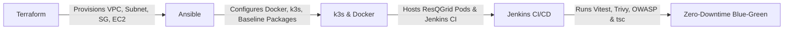

# Ansible Configuration Management & SonarQube Integration — ResQGrid

This directory contains the automated server configuration management, SonarQube environment preparation, and cluster audit suite for the **ResQGrid** disaster alert and response platform.

---

## 1. Architectural Shift: From Cloud-Init to Pure Ansible

In early iterations, the server was bootstrapped using cloud-init (`user_data` in Terraform). We refactored this to achieve strict enterprise separation of concerns:

- **Terraform (Day-0 Infrastructure):** Exclusively provisions cloud resources (AWS VPC, Subnets, Internet Gateway, Security Groups, EC2 instance). Cloud-init `user_data` has been completely stripped from `infra/terraform/compute.tf`.
- **Ansible (Day-1 & Day-2 Operations):** Connects to the bare EC2 host over AWS SSM Session Manager and idempotently provisions the environment (Docker, k3s, SonarQube requirements, and security baselines).

---

## 2. Directory & Role Architecture

```
ansible/
├── ansible.cfg                # Global Ansible configuration (SSH over AWS SSM, pipelining)
├── group_vars/
│   └── all.yml                # Environment variables, package lists, service states
├── inventory/
│   └── hosts.ini              # Managed hosts definition using SSH alias 'resqgrid-dev'
├── playbooks/
│   ├── site.yml               # Master orchestration entrypoint
│   └── server_setup.yml       # Server configuration and audit playbook
├── roles/
│   ├── common/                # Role: Baseline system utilities, OS assertions, workspace
│   ├── docker/                # Role: Docker engine status and container verification
│   └── verification/          # Role: k3s status, pod health, disk/memory assertions
└── README.md                  # Comprehensive viva guide & documentation
```

---

## 3. Lightweight Security & Quality Architecture (Why SonarQube Was Replaced)

During development, running a full **SonarQube Server** was evaluated. However, SonarQube’s JVM and embedded Elasticsearch engine require **3 to 4 GiB of dedicated RAM** (`-Xms2g -Xmx2g`), which would consume nearly 100% of our 4 GiB EC2 instance and cause Out-Of-Memory (OOM) kernel panics with Jenkins and Kubernetes running concurrently.

To achieve superior code quality and security without the memory bloat, we implemented a specialized 3-tier cloud-native stack:
1. **Static Code Quality & Type Safety:** Strict TypeScript compiler checking (`tsc --noEmit`) in [backend/package.json](file:///C:/Users/baran/Downloads/Devops_project/backend/package.json#L15) and [frontend/package.json](file:///C:/Users/baran/Downloads/Devops_project/frontend/package.json#L12).
2. **Container & Filesystem SAST:** **Aqua Trivy 0.76.2**, scanning for CVE vulnerabilities, misconfigurations, and exposed credentials (< 150 MB RAM).
3. **Software Supply Chain Security (SCA):** **OWASP Dependency-Check 12.1.0**, auditing npm dependencies against the NIST National Vulnerability Database.

---

## 4. Execution & Verification Runbook

All commands are executed from the `ansible/` root directory:

```bash
cd /mnt/c/Users/baran/Downloads/Devops_project/ansible
export ANSIBLE_CONFIG=ansible.cfg

# 1. Validate Playbook Syntax
ansible-playbook -i inventory/hosts.ini playbooks/site.yml --syntax-check

# 2. Test Host Connectivity (Ad-hoc Ping)
ansible -i inventory/hosts.ini all -m ping

# 3. Dry-Run / Check Mode
ansible-playbook -i inventory/hosts.ini playbooks/site.yml --check

# 4. Execute Full Playbook
ansible-playbook -i inventory/hosts.ini playbooks/site.yml
```

---

## 5. Viva Demonstration Sequence



1. **Terraform (Day 0):** Pure cloud IaC with zero embedded bash user-data.
2. **Ansible (Day 1 / Day 2):** Idempotent configuration management over zero-trust AWS SSM.
3. **Vitest + Trivy + OWASP + tsc:** Complete 4-tier security & quality gate with low RAM footprint.
4. **Kubernetes (k3s):** Orchestrates ResQGrid microservices, PostgreSQL, Prometheus, Grafana, and Alertmanager.
