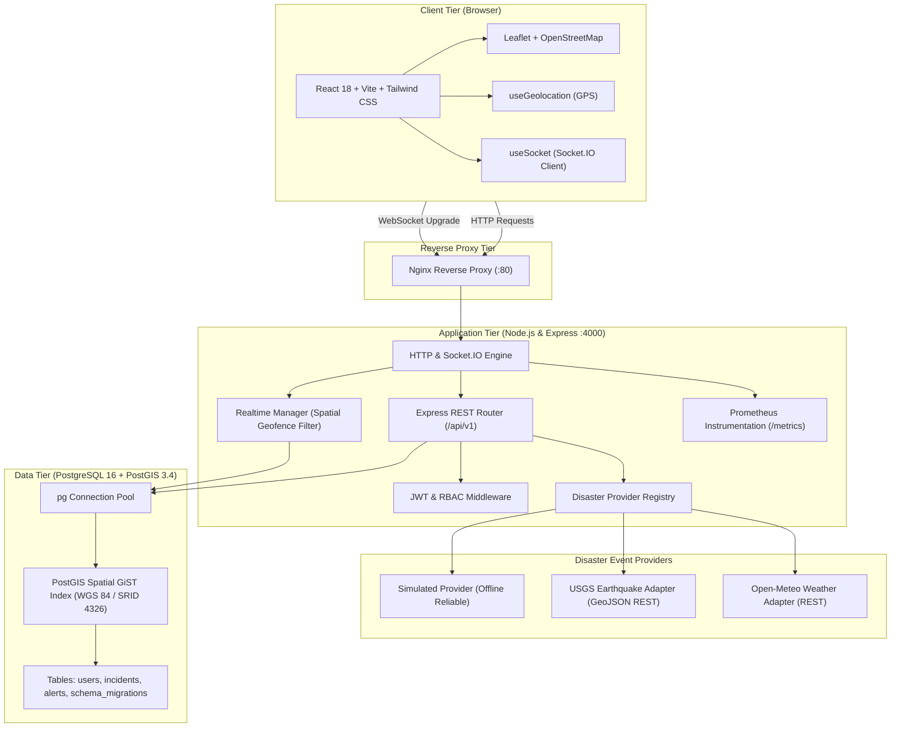
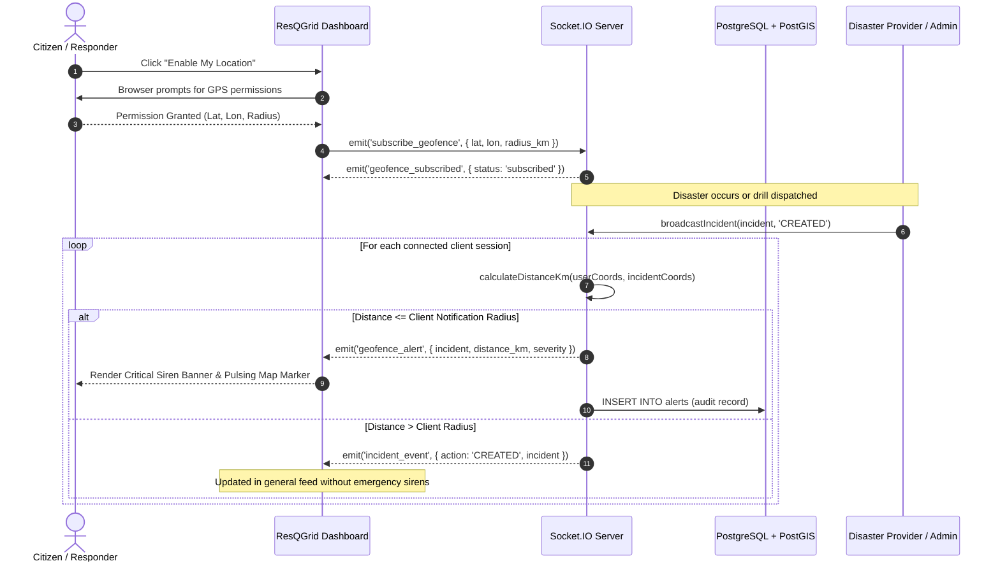
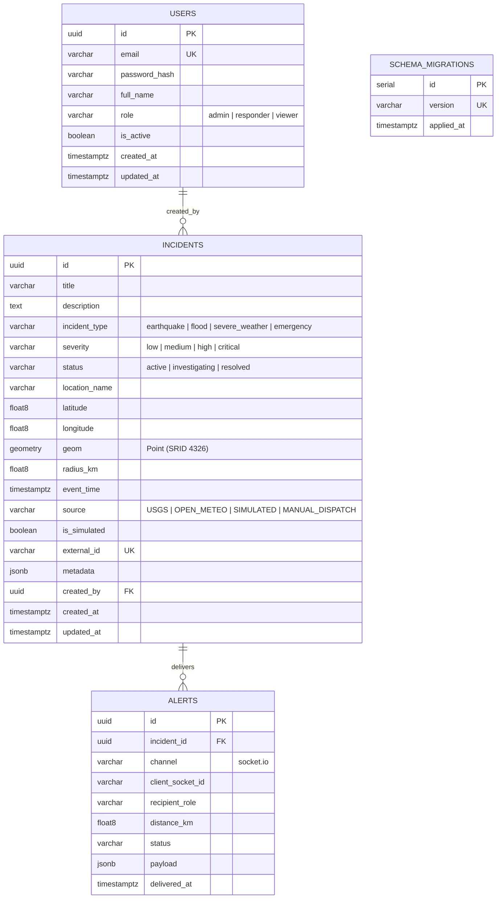

# ResQGrid — Architecture & Data Flow (Phase 1)

## 1. System Overview

**ResQGrid** is a real-time disaster alert and response platform engineered for civil protection authorities, emergency responders, and communities. It serves as the functional foundation for a final-year Computer Science & Engineering project at SRM Institute of Science and Technology.

The platform couples spatial computation (PostgreSQL with PostGIS) and sub-second bi-directional WebSocket communication (Socket.IO) to deliver targeted, geofenced alerts without exposing user location data or broadcasting irrelevant alerts to remote clients.

---

## 2. Geofence Alerting Data Flow

The geofence alerting system ensures that connected clients only receive high-priority alerts relevant to their configured geographic notification radius.

---

## 3. Database Entity-Relationship Diagram

The relational model tracks users with Role-Based Access Control (`admin`, `responder`, `viewer`), disaster incidents with native PostGIS spatial points and GiST indexing, and alert audit records.

---

## 4. Key Architectural Decisions

### 4.1 PostGIS Spatial Querying
- PostGIS `geography` type on the WGS 84 ellipsoid (SRID 4326) computes distances natively in meters using `ST_DWithin` and `ST_Distance`.
- A GiST index (`CREATE INDEX idx_incidents_geom ON incidents USING GIST (geom);`) ensures sub-millisecond execution times even with millions of records.
- In-memory Haversine formula is used as a complementary validation layer and fast path in WebSocket connection handlers.

### 4.2 Separation of Concerns & Provider Abstraction
- The `DisasterEventProvider` interface defines a clean contract (`fetchEvents()`, `healthCheck()`, `isSimulated`).
- External APIs (USGS, Open-Meteo) have independent timeouts (`AbortController`) and graceful degradation: if an external API fails or times out, the platform logs a warning, increments an error metric, and continues normal operation.
- Simulated events are strictly flagged (`is_simulated = true`) to prevent mistaking drills for official civil emergencies.

### 4.3 Blue-Green Deployment & Migration Compatibility
- Schema migrations use explicit forward-compatible DDL (`CREATE TABLE IF NOT EXISTS`, `ADD COLUMN IF NOT EXISTS`, triggers).
- Version tracking is recorded in `schema_migrations`.
- Seeds use `ON CONFLICT DO UPDATE` to guarantee repeatable, idempotent application.

### 4.4 Observability & Monitoring Foundations
- Liveness (`/health/live`) and readiness (`/health/ready`) endpoints provide clean Kubernetes / Docker orchestration hooks.
- Prometheus metrics (`/metrics`) track request counts, latencies (histogram), active socket connections, and ingestion counts without high-cardinality labels.
