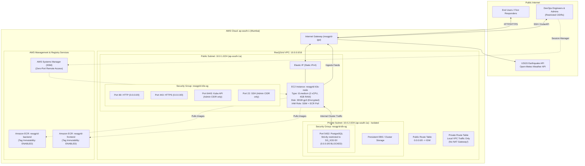

# ResQGrid — AWS Cloud Infrastructure & Terraform Guide

**Academic Context:** SRM Institute of Science and Technology — CSE Final Year  
**Phase:** 2 — Cloud Infrastructure & Infrastructure as Code (IaC)  
**IaC Tool:** HashiCorp Terraform v1.16+  
**Target AWS Region:** `ap-south-1` (Mumbai)  

---

## 1. Network Topology & Isolation Overview

The AWS infrastructure is provisioned strictly through modular Terraform configurations located in [infra/terraform/](file:///c:/Users/baran/Downloads/Devops_project/infra/terraform/). The network enforces clear segregation between internet-facing components and private data layers while avoiding redundant, expensive managed services.



---

## 2. Infrastructure Resources Specification

### A. Virtual Private Cloud (VPC) & Subnets
- **VPC CIDR:** `10.0.0.0/16` ([infra/terraform/vpc.tf](file:///c:/Users/baran/Downloads/Devops_project/infra/terraform/vpc.tf))
  - `enable_dns_hostnames = true`
  - `enable_dns_support = true`
- **Public Subnet (`10.0.1.0/24`):**
  - Hosted in `ap-south-1a`.
  - `map_public_ip_on_launch = true`.
  - Route table points `0.0.0.0/0` to the attached Internet Gateway (`aws_internet_gateway.igw`).
  - Hosts the k3s cluster single-node instance.
- **Private Subnet (`10.0.2.0/24`):**
  - Hosted in `ap-south-1a`.
  - `map_public_ip_on_launch = false`.
  - Isolated route table containing only the internal local route `10.0.0.0/16`.
  - **No NAT Gateway is attached.**

### B. Architectural Rationale: Omission of AWS Managed NAT Gateway
Managed NAT Gateways in AWS charge:
- **Hourly Base Fee:** \$0.045/hour = **\$32.40 / month**.
- **Data Processing Fee:** \$0.045 / GB processed.

For student projects and small-to-medium institutional deployments, paying \$32.40/mo solely to route egress traffic from private subnets represents unnecessary financial waste. ResQGrid places the k3s Kubernetes node directly in the public subnet, secures it with strict security group boundaries and non-root containers, and keeps the database port completely unexposed to the Internet. This achieves strong network isolation while eliminating 100% of NAT Gateway charges.

### C. Compute Instance (`aws_instance.k3s_host`)
- **Instance Type:** `t3.medium` (2 vCPU, 4 GiB Memory, burstable compute with AWS Nitro System).
- **Operating System:** Ubuntu 22.04 LTS (Jammy Jellyfish x86_64) dynamically queried via `aws_ami.ubuntu`.
- **Root Block Device:** 30 GiB `gp3` SSD storage with `encrypted = true`, 3000 IOPS, and 125 MB/s throughput baseline.
- **Elastic IP:** `aws_eip.k3s_eip` ensures a static public IP address that persists across instance stops and starts.
- **Automated Bootstrap (`user_data`):** Automatically installs OS security updates, AWS CLI v2, and boots lightweight k3s Kubernetes with built-in Traefik Ingress controller and metrics-server.

### D. Identity & Access Management (IAM Least Privilege)
- **Role:** `resqgrid-k3s-node-role-staging` ([infra/terraform/iam.tf](file:///c:/Users/baran/Downloads/Devops_project/infra/terraform/iam.tf))
- **Assumed by:** `ec2.amazonaws.com`
- **Attached Policies:**
  1. `resqgrid-ecr-pull-policy`: Restricts ECR operations strictly to `ecr:GetAuthorizationToken` and read-only layer pulls (`ecr:BatchCheckLayerAvailability`, `ecr:GetDownloadUrlForLayer`, `ecr:BatchGetImage`) scoped exclusively to the two ResQGrid repositories. Write and delete permissions are withheld.
  2. `arn:aws:iam::aws:policy/AmazonSSMManagedInstanceCore`: Enables AWS Systems Manager Session Manager, allowing engineers to open encrypted shell sessions via the AWS Console or AWS CLI without opening port 22 to the public internet.

### E. Amazon Elastic Container Registry (ECR)
- **Repositories:** `resqgrid-backend` and `resqgrid-frontend` ([infra/terraform/ecr.tf](file:///c:/Users/baran/Downloads/Devops_project/infra/terraform/ecr.tf)).
- **Tag Immutability:** `image_tag_mutability = "IMMUTABLE"`. Prevents overwriting release tags, ensuring that any deployed Git SHA matches the original scanned image.
- **Vulnerability Scanning:** `scan_on_push = true`. AWS automatically triggers scanning upon push.
- **Lifecycle Policy:**
  - Deletes untagged dangling images after 3 days.
  - Retains only the last 15 tagged images, preventing unbounded storage growth.

### F. Security Group Firewalls
- **`resqgrid-k3s-sg`:**
  - Ingress: Port 80 (HTTP) & 443 (HTTPS) open to `0.0.0.0/0`.
  - Ingress: Port 6443 (Kubernetes API) & Port 22 (SSH) restricted to authorized `var.admin_cidr_blocks`.
  - Ingress: Intra-cluster traffic allowed from `self = true`.
  - Egress: Full outbound access to pull images and fetch USGS/weather feeds.
- **`resqgrid-db-sg`:**
  - Ingress: Port 5432 (PostgreSQL) allowed **strictly** from `resqgrid-k3s-sg.id`.
  - Egress: Restricted strictly to VPC internal CIDR `10.0.0.0/16`.

---

## 3. Terraform Operations & Validation

### Formatting & Syntax Validation
```bash
# Navigate to Terraform workspace
cd infra/terraform

# Format all HCL manifests
terraform fmt

# Initialize providers without remote state
terraform init -backend=false

# Validate schema correctness
terraform validate
```
*Verification Result:* `Success! The configuration is valid.`

### Execution Plan Generation (When Credentials Available)
```bash
# Review plan against AWS account
terraform plan -out=tfplan.binary
```

> [!CAUTION]
> In accordance with project instructions, `terraform apply` is **never executed automatically**. Infrastructure provisioning must be initiated by authorized team members with explicit budget approval.
