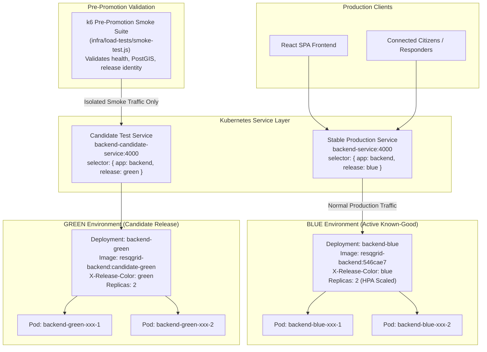
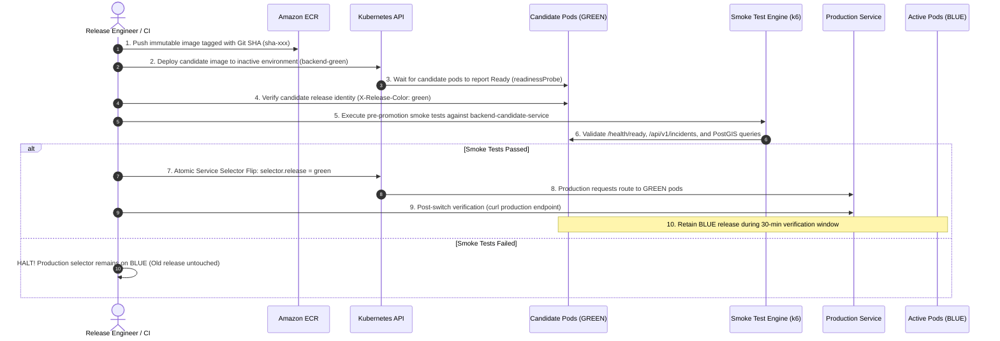

# ResQGrid — Blue-Green Deployment Architecture & Operational Runbook

**Academic Evaluation Context:** SRM Institute of Science and Technology — CSE Final Year  
**Phase:** 3 — Release Reliability, Blue-Green Traffic Switching & Smoke Testing  
**Workload Target:** `backend-blue`, `backend-green`, and `backend-service` in namespace `resqgrid`  

---

## 1. Architectural Principles & Zero-Downtime Philosophy

ResQGrid implements a true **Kubernetes Blue-Green Deployment** pattern. Unlike standard rolling updates where pods are replaced in-place inside a single Deployment, blue-green release management maintains two independently identifiable environments:
- **BLUE:** The active, known-good production environment currently receiving production traffic.
- **GREEN:** The idle or candidate environment where the new release is deployed and validated in total isolation.



---

## 2. The 10-Step Release Lifecycle



---

## 3. Observable Release Identity Mechanism

To eliminate ambiguity regarding which release is serving traffic, ResQGrid embeds deterministic release identity at three distinct layers:

1. **HTTP Response Header:** Every response dispatched by the backend includes:
   ```http
   X-Release-Color: blue    # or 'green'
   X-Release-Commit: 546cae7
   ```
2. **Dedicated Version Endpoint (`/health/version`):**
   ```json
   {
     "color": "blue",
     "commit": "546cae7",
     "environment": "production",
     "timestamp": "2026-10-16T20:04:01.238Z"
   }
   ```
3. **Frontend Header Badge:** The React application header polls `/health/version` and renders a live, glowing badge:
   - `Release: BLUE` (Indigo pill during Blue release)
   - `Release: GREEN` (Emerald animated pulse during Green release)

---

## 4. Step-by-Step Execution Commands

### Executing Blue-Green Deployment on Linux / Jenkins Runner
```bash
# Deploy candidate image and perform automated traffic switch
./infra/k8s/deploy-candidate.sh "123456789012.dkr.ecr.ap-south-1.amazonaws.com/resqgrid-backend:sha-546cae7" "546cae7"
```

### Executing Blue-Green Deployment on Windows (PowerShell)
```powershell
# Live deployment against connected cluster
.\infra\k8s\deploy-candidate.ps1 -ImageTag "resqgrid-backend:sha-546cae7" -GitCommit "546cae7"

# Offline Dry-Run demonstration (for academic evaluation without live AWS)
.\infra\k8s\deploy-candidate.ps1 -DryRun
```

### Dry-Run Execution Log (Verified Evidence)
```
========================================================================
 Starting ResQGrid Blue-Green Deployment
 Image:      resqgrid-backend:latest
 Git Commit: 546cae7
 Namespace:  resqgrid
========================================================================
[1/6] Current ACTIVE release:    blue
[1/6] Target CANDIDATE release: green
[2/6] Updating candidate Deployment: backend-green...
  [DRY-RUN] Simulated image & env injection: backend=resqgrid-backend:latest
[3/6] Aligning backend-candidate-service selector to green...
  [DRY-RUN] Simulated service patch: backend-candidate-service -> green
[4/6] Waiting for candidate deployment rollout...
  [DRY-RUN] Simulated rollout wait (Status: 2/2 Replicas Ready)
[5/6] Executing automated smoke tests against candidate environment...
  [DRY-RUN] Simulated candidate smoke tests: ALL CHECKS PASSED (100% rate)
[6/6] All checks PASSED! Switching production Service to green...
  [DRY-RUN] Simulated atomic selector patch: backend-service selector.release = green
========================================================================
 Blue-Green Promotion Completed Successfully!
 Previous Release:  blue
 Promoted Release:  green
 Active Image Tag:  resqgrid-backend:latest
========================================================================
```

---

## 5. WebSocket Reconnection & State Recovery

### The Truth About "Zero Downtime"
Engineering honesty is paramount: **HTTP REST endpoints achieve zero-downtime** because atomic Service selector flips route subsequent TCP connections immediately to the new pods. However, **persistent WebSocket connections (Socket.IO) connected to old pods will eventually reconnect** as the old pods are terminated or their connections cycled.

### ResQGrid WebSocket Resilience Flow:
1. When traffic flips from BLUE to GREEN, existing clients remain connected to BLUE during the verification window.
2. If BLUE is decommissioned, Socket.IO client automatically detects socket disconnection.
3. Socket.IO immediately re-establishes a WebSocket connection to the ingress, which routes to GREEN.
4. Upon reconnection, the client dispatches the `request_sync` event with its `lastSyncTime`.
5. The GREEN pod queries PostgreSQL for any incidents updated or ingested while the client was reconnecting and returns `sync_data`.
6. No disaster alerts are dropped.

---

## 6. Retention Window & Safe Decommissioning

Following promotion to GREEN:
- **Immediate retention:** The BLUE deployment is kept running at 2 replicas for **30 minutes**.
- **Post-verification drain:** Once the 30-minute verification window concludes without error rate alarms, BLUE is scaled to 0 replicas (`kubectl scale deployment backend-blue --replicas=0`) to conserve EC2 host memory while remaining instantly available for rollbacks.
