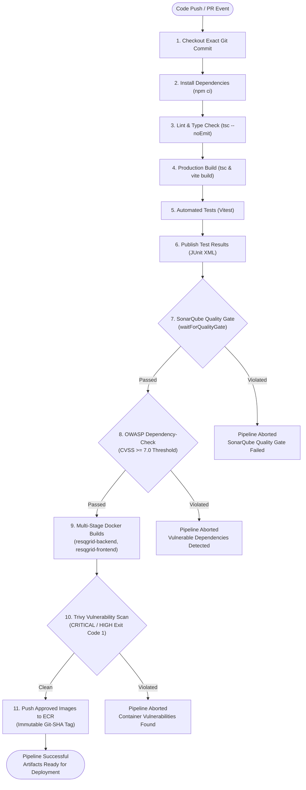

# ResQGrid — Jenkins CI/CD Pipeline & Orchestration Guide

**Academic Context:** SRM Institute of Science and Technology — CSE Final Year  
**Phase:** 2 — Continuous Integration, Static Analysis, Vulnerability Scanning & Image Delivery  
**Orchestrator:** Jenkins (Declarative Pipeline)  
**Pipeline Definition:** [Jenkinsfile](file:///c:/Users/baran/Downloads/Devops_project/Jenkinsfile)  

---

## 1. CI/CD Philosophy & Requirements

ResQGrid strictly employs **Jenkins as the sole CI/CD orchestrator**. In adherence to project guidelines, third-party managed pipelines like GitHub Actions or GitLab CI are completely excluded. The pipeline enforces a zero-trust build lifecycle where software artifacts are promoted to container registries only after passing all code-quality, functional-test, and security-vulnerability gates.



---

## 2. Required Jenkins Setup & Plugins

To execute the ResQGrid Declarative Pipeline, the Jenkins controller requires the following plugins and configured system tools:

### Installed Plugins
| Plugin Name | Plugin ID | Purpose |
| :--- | :--- | :--- |
| **Pipeline** | `workflow-aggregator` | Core engine for declarative pipeline execution |
| **Git Plugin** | `git` | Clones target repositories and manages commit SHAs |
| **SonarQube Scanner** | `sonar` | Injects SonarQube CLI and captures analysis metrics |
| **OWASP Dependency-Check** | `dependency-check-jenkins-plugin` | Executes dependency scans and renders vulnerability trends |
| **JUnit Plugin** | `junit` | Parses JUnit XML reports from Vitest |
| **Docker Pipeline** | `docker-workflow` | Manages local Docker container builds and image packaging |
| **Amazon ECR** | `amazon-ecr` | Handles authenticated Docker pushes to AWS ECR |
| **Credentials Binding** | `credentials-binding` | Injects secrets into build steps securely |

### Jenkins Credentials Store
1. `github-webhook-secret`: Secret text containing HMAC token for GitHub push triggers.
2. `sonar-token`: Secret text generated from SonarQube administrative account.
3. `aws-ecr-credentials`: AWS IAM access key and secret key authorized to push to ECR.

---

## 3. GitHub Webhook Integration

To trigger pipeline builds on every branch commit and pull request:
1. Open the GitHub repository settings: `Settings > Webhooks > Add webhook`.
2. **Payload URL:** `http://<JENKINS_HOST>:8080/github-webhook/`
3. **Content type:** `application/json`
4. **Secret:** Provide the token stored in Jenkins `github-webhook-secret`.
5. **Which events would you like to trigger this webhook?**
   - Select: *Let me select individual events*.
   - Check: `Pushes` and `Pull requests`.
6. Confirm by clicking **Add webhook**.

---

## 4. Pipeline Stages & Failure Thresholds

### Stage 1: Checkout Commit
Clones the exact commit SHA that triggered the build using Git depth optimization (`depth: 1` on feature branches).

### Stage 2: Install Dependencies
Runs `npm ci` reproducibly across workspaces to ensure identical dependency trees between local environments and the CI runner.

### Stage 3: Lint & Type-Check
Executes `npm run lint` (`tsc --noEmit` across backend and frontend workspaces). Any compiler error or strict type mismatch terminates the build immediately.

### Stage 4: Production Build
Executes `npm run build` (`tsc` for backend, `tsc && vite build` for frontend). Verifies that static assets, JavaScript bundles, and server bundles compile without runtime import flaws.

### Stage 5 & 6: Automated Tests & Test Reporting
- Executes backend and frontend Vitest suites with JUnit reporters.
- Generates `backend/junit.xml` and `frontend/junit.xml`.
- **JUnit Plugin Step:** `junit testResults: '**/junit.xml', allowEmptyResults: false`.
- **Failure Threshold:** If any of the **81 tests** fails, the build status turns `FAILED` and execution halts.

### Stage 7: SonarQube Analysis & Quality Gate
- Injects environment from `withSonarQubeEnv('SonarQube-Server')`.
- Runs `sonar-scanner` using configuration defined in [sonar-project.properties](file:///c:/Users/baran/Downloads/Devops_project/sonar-project.properties).
- **Quality Gate Step:**
  ```groovy
  timeout(time: 5, unit: 'MINUTES') {
      def qg = waitForQualityGate()
      if (qg.status != 'OK') {
          error "SonarQube Quality Gate Failure: ${qg.status}"
      }
  }
  ```
- **Failure Threshold:** Any new code bugs, vulnerabilities, security hotspots, or code coverage drop below 80% terminates the build.

### Stage 8: OWASP Dependency-Check
- Scans `package-lock.json` and node modules against the National Vulnerability Database (NVD).
- Suppressions defined in [dependency-check-suppressions.xml](file:///c:/Users/baran/Downloads/Devops_project/dependency-check-suppressions.xml).
- **Failure Threshold:** Generates warning if CVSS score is between 4.0 and 6.9; **hard-fails build if any dependency has a CVSS score ≥ 7.0**.

### Stage 9: Docker Container Build
- Builds multi-stage production Docker images using:
  - `infra/docker/backend.Dockerfile`
  - `infra/docker/frontend.Dockerfile`
- Tags images with immutable Git commit SHA:
  - `resqgrid-backend:sha-${GIT_COMMIT}`
  - `resqgrid-frontend:sha-${GIT_COMMIT}`

### Stage 10: Trivy Image Vulnerability Scan
- Scans both built container images for operating system and application layer vulnerabilities:
  ```bash
  trivy image --severity HIGH,CRITICAL --exit-code 1 --ignore-unfixed resqgrid-backend:sha-${GIT_COMMIT}
  trivy image --severity HIGH,CRITICAL --exit-code 1 --ignore-unfixed resqgrid-frontend:sha-${GIT_COMMIT}
  ```
- **Failure Threshold:** If even a single HIGH or CRITICAL unfixed vulnerability is discovered, Trivy exits with code `1`, immediately blocking image push.

### Stage 11: Push Approved Images to ECR
- Re-tags images with the ECR repository URI.
- Authenticates via AWS CLI or Docker credentials helper.
- Pushes immutable SHA tags to `aws_ecr_repository.backend` and `aws_ecr_repository.frontend`.
- Immutable tags guarantee that no image can ever be rewritten or compromised in transit.
