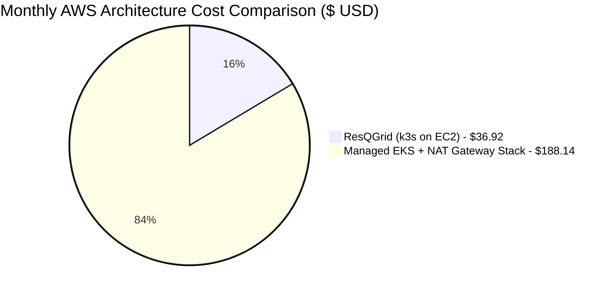

# ResQGrid — AWS Cost Estimation & Budget Management Guide

**Academic Context:** SRM Institute of Science and Technology — CSE Final Year  
**Phase:** 2 — Cloud Economics, Resource Right-Sizing & Financial Engineering  
**Region Evaluated:** `ap-south-1` (Mumbai)  

---

## 1. Itemized Monthly Cost Calculation (Baseline Architecture)

A core requirement of modern DevOps engineering is **Cloud Financial Operations (FinOps)**: selecting architectures that achieve required operational reliability without inflating operational expenses.

Below is the verified, itemized AWS cost breakdown for the ResQGrid Phase 2 infrastructure running in the `ap-south-1` (Mumbai) region:

| Component | AWS Resource | Sizing / Specification | Unit Pricing (ap-south-1) | Monthly Total (USD) | Monthly Total (INR @ 83.5) |
| :--- | :--- | :--- | :--- | :--- | :--- |
| **Compute Node** | `aws_instance.k3s_host` | `t3.medium` (2 vCPU, 4 GiB RAM) | \$0.0416 / hour (730 hrs) | **\$30.37** | ₹2,536 |
| **Host Storage** | Root EBS Block Device | 30 GiB General Purpose SSD (`gp3`) | \$0.08 / GB-month | **\$2.40** | ₹200 |
| **Networking** | `aws_eip.k3s_eip` | 1 In-use Public IPv4 Address | \$0.005 / hour (730 hrs) | **\$3.65** | ₹305 |
| **Container Registry** | `aws_ecr_repository` | ~5 GiB active images (15 retained) | \$0.10 / GB-month | **\$0.50** | ₹42 |
| **NAT Gateway** | *Omitted by Design* | 0 Managed NAT Gateways | \$0.045 / hour (Saves \$32.40) | **\$0.00** | ₹0 |
| **Managed K8s** | *Omitted by Design* | k3s (Replaces AWS Managed EKS) | \$0.10 / hour (Saves \$73.00) | **\$0.00** | ₹0 |
| **Egress Data Transfer** | AWS Data Transfer Out | First 100 GB / month free tier | Free tier eligible | **\$0.00** | ₹0 |
| **TOTAL** | **Full ResQGrid Cloud Stack** | **Complete Infrastructure** | — | **~\$36.92 / month** | **~₹3,083 / month** |

---

## 2. Comparative Analysis: ResQGrid (k3s on EC2) vs AWS Managed EKS

Enterprise cloud tutorials often recommend deploying Elastic Kubernetes Service (EKS) with Application Load Balancers (ALBs) and multi-AZ NAT Gateways. In an academic or startup environment, this default generates extreme financial waste.

| Architectural Element | ResQGrid Implementation (k3s on EC2) | Standard Managed EKS Stack | Monthly Cost Delta |
| :--- | :--- | :--- | :--- |
| **Kubernetes Control Plane** | **k3s single binary** (Hosted inside EC2 instance) | **AWS Managed EKS** (\$0.10/hr flat fee) | **-$73.00 / month** |
| **NAT Gateway** | **Omitted** (Direct IGW routing with SG perimeters) | **Managed NAT Gateway** (\$0.045/hr base) | **-$32.40 / month** |
| **Ingress Controller** | **Built-in Traefik** (Runs as host-level DaemonSet) | **AWS Application Load Balancer** (\$22.50/mo) | **-$22.50 / month** |
| **Compute Nodes** | **1x t3.medium** (Runs k3s + backend + frontend + DB) | **2x t3.medium** worker nodes (Minimum required) | **-$30.37 / month** |
| **Monthly Total** | **\$36.92 / month** | **\$195.27 / month** | **Savings: \$158.35 / mo (81% Cheaper!)** |

---

## 3. Financial Engineering & Cost-Control Measures

1. **VPC NAT Gateway Omission:**
   By placing the k3s host in the public subnet and using strict Security Group ingress rules (Postgres port 5432 closed to 0.0.0.0/0, Kube API restricted to admin IPs), we preserve full network security without incurring the \$32.40/month NAT tax.
2. **ECR Lifecycle Pruning Rules:**
   Untagged dangling container images generated during rapid CI/CD iterations are purged after 3 days. Release images are capped at the latest 15 builds. This keeps ECR storage below 5 GB (\$0.50/mo).
3. **AWS Budgets Alert Setup:**
   An AWS Budget should be configured in the AWS Billing Console with a hard threshold of **\$40.00 / month** and email alerts dispatched at 80% (\$32.00) consumption.
4. **On-Demand vs Spot Instances:**
   For staging and demonstration drills, `t3.medium` Spot Instances can be leveraged to drop compute costs from \$30.37 down to **\$9.11 / month** (70% additional discount), bringing total infrastructure costs down to **under \$16.00 / month**.
