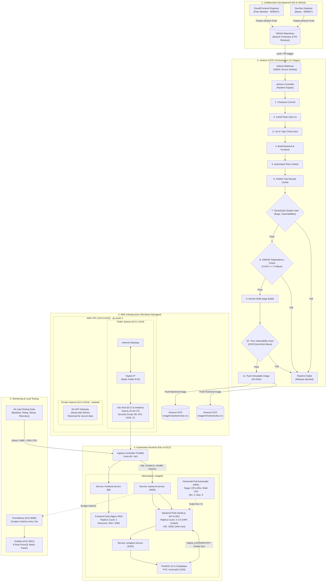

# ResQGrid — DevOps & Cloud Deployment Architecture

**Academic Evaluation Context:** SRM Institute of Science and Technology — CSE Final Year Capstone Project  
**Phase:** 2 — Cloud Infrastructure, CI/CD, Containerization, Kubernetes, Autoscaling & Monitoring  

---

## 1. Executive Summary & Architecture Overview

ResQGrid is an event-driven, real-time disaster alert and response platform designed to provide rapid situational awareness and geospatial hazard notifications during emergencies. Phase 2 transitions ResQGrid from a local containerized application into a production-grade, highly observable, autoscaling cloud deployment on Amazon Web Services (AWS) using Infrastructure as Code (Terraform), Jenkins CI/CD with multi-layer security gates, Kubernetes (k3s), and Prometheus/Grafana observability.

### Core Architectural Principles
1. **Cost-Conscious Cloud Engineering:** Designed for high efficiency without wasteful expenditure. By leveraging a single-node/worker k3s cluster on an AWS `t3.medium` instance and avoiding managed AWS NAT Gateways ($32.40/mo) and managed EKS cluster control plane fees ($73.00/mo), the complete platform runs for under **$37.00/month**.
2. **Shift-Left Security & Provenance:** Every build must pass SonarQube quality gates (Zero bugs/vulnerabilities, >80% coverage), OWASP Dependency-Check (no CVSS ≥ 7.0), and Trivy container vulnerability scanning (zero CRITICAL/HIGH CVEs) before container images are pushed to Amazon ECR with immutable Git-SHA tags.
3. **Stateless Scalability with Native PostgreSQL Pub/Sub:** Real-time WebSockets scale horizontally across multiple backend pods without introducing heavy dependencies like Redis or Kafka, utilizing PostgreSQL `LISTEN/NOTIFY` cluster bus.
4. **End-to-End Observability:** Real application metrics instrumented with `prom-client` scraped every 15 seconds by Prometheus, visualized on Grafana with custom PromQL panels, and monitored by alerting rules.

---

## 2. End-to-End DevOps Architecture Diagram

---

## 3. Technology Stack Reference & Responsibilities

| Tier / Component | Technology | Version | Architectural Responsibility |
| :--- | :--- | :--- | :--- |
| **VCS** | Git / GitHub | v2.40+ | 2-member branch collaboration, PR templates, CODEOWNERS, commit linting |
| **CI/CD Orchestrator** | Jenkins | v2.440+ (LTS) | Sole pipeline engine; runs 11-stage declarative verification & image pushing |
| **Static Code Analysis** | SonarQube Scanner | v5.0+ | Enforces Quality Gate: 0 bugs, 0 vulnerabilities, 0 security hotspots |
| **SCA Dependency Scanner** | OWASP Dependency-Check | v9.0+ | Scans NPM dependencies; halts builds on any CVE with CVSS score ≥ 7.0 |
| **Container Engine** | Docker BuildKit | v25.0+ | Builds multi-stage non-root container images for frontend and backend |
| **Container Security** | Aqua Trivy | v0.50+ | Scans Docker images for OS and package vulnerabilities; halts on HIGH/CRITICAL |
| **Image Registry** | Amazon ECR | AWS Native | Stores immutable, AES256-encrypted container images tagged with Git commit SHAs |
| **IaC** | HashiCorp Terraform | v1.16+ | Provisons AWS VPC, Subnets, Route Tables, Security Groups, IAM Roles, and EC2 |
| **Cloud Provider** | Amazon Web Services (AWS) | ap-south-1 | Regional hosting in Mumbai for low latency to SRMIST Chennai |
| **Container Orchestration** | k3s (Lightweight Kubernetes) | v1.28+ | Manages Deployments, Services, ConfigMaps, Secrets, Ingress, and HPA |
| **Autoscaling** | Kubernetes HPA + Metrics-Server | v2 autoscaling | Dynamically scales backend pods between 2 and 6 replicas based on CPU & Memory |
| **Cluster Database** | PostgreSQL + PostGIS | 16-3.4 | Geospatial point/polygon storage and multi-pod WebSocket pub/sub bus |
| **Metrics Collection** | Prometheus | v2.50+ | Scrapes application runtime metrics and evaluates alert rules |
| **Dashboards** | Grafana | v10.3+ | Visualizes 8 custom PromQL panels for requests, latency, errors, and resources |
| **Load Testing** | Grafana k6 | v2.2+ | Executes controlled baseline, ramp-up, spike (HPA trigger), and recovery tests |

---

## 4. Multi-Replica State Synchronization (PostgreSQL LISTEN/NOTIFY)

In Phase 1, WebSockets were hosted in-process inside the backend instance. In Phase 2, Kubernetes runs 2 to 6 backend replicas simultaneously. If User A connects to Pod 1, and an incident is created or ingested on Pod 2, User A would not receive the alert without a cluster bus.

To solve this without adding costly Redis or Kafka microservices:
1. Every backend pod connects to PostgreSQL and issues `LISTEN resqgrid_cluster_events`.
2. When any pod creates or ingests an incident, it executes `SELECT pg_notify('resqgrid_cluster_events', payload)`.
3. All running backend pods instantly receive the PostgreSQL notification and broadcast the alert to their locally connected WebSocket clients.
4. If the database connection temporarily drops, pods log the disconnection and attempt exponential backoff reconnection.

---

## 5. Security & Isolation Model

- **Public Subnet:** Only the k3s host is placed in the public subnet, mapped to a static Elastic IP. Ingress ports 80 (HTTP) and 443 (HTTPS) are open to the internet.
- **Administrative Ports:** Port 22 (SSH) and 6443 (Kubernetes API) are restricted via Security Groups to authorized administrator IP addresses (`admin_cidr_blocks`). In addition, AWS SSM Session Manager is attached to the IAM role for zero-trust CLI access without requiring port 22 open.
- **Database Perimeter:** The database port 5432 is strictly bound to the private cluster network and accepts traffic exclusively from the k3s security group. No public IPv4 address or route exists to the database.
- **Container Hardening:** Backend pods run under dedicated non-root user `UID 10001` (`resqgroup`), with `allowPrivilegeEscalation: false`, dropped Linux capabilities (`drop: ["ALL"]`), and a `readOnlyRootFilesystem: true` backed by a temporary `emptyDir` mount for `/tmp`.
