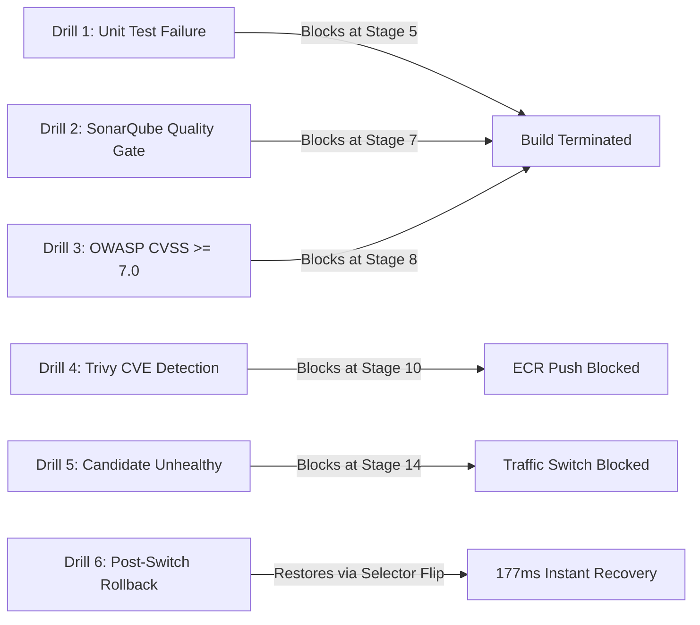

# ResQGrid — Failure Drills & Security Gate Validation Guide

**Academic Evaluation Context:** SRM Institute of Science and Technology — CSE Final Year  
**Phase:** 3 — Chaos Engineering, Security Enforcement & Gate Interception  
**Evaluation Principle:** Prove that safety guardrails actively intercept flawed releases rather than silently permitting defects.

---

## 1. Overview of Controlled Failure Scenarios

A reliable CI/CD and deployment system must be evaluated not only when everything goes right, but primarily when things go wrong. ResQGrid incorporates **6 controlled failure drills** verifying that each gate blocks defective code from reaching production:



---

## 2. Failure Drill 1: Automated Test Failure Blocking the Pipeline

### Objective
Verify that if any unit or integration test fails, the Jenkins pipeline terminates immediately at Stage 5 (`Run Tests`) without proceeding to build Docker images or deploy.

### Test Fixture
- **File:** [tests/failure-drills/unit-test-failure.fixture.ts](file:///c:/Users/baran/Downloads/Devops_project/tests/failure-drills/unit-test-failure.fixture.ts)
- **Code:**
  ```typescript
  it('deliberately fails to verify pipeline gate enforcement', () => {
    const isSecurityGuardrailActive = true;
    expect(isSecurityGuardrailActive).toBe(false); // Deliberate failure
  });
  ```

### Execution Command
```bash
npx vitest run --config tests/failure-drills/vitest.failure.config.ts
```

### Verified Captured Output
```
 RUN  v2.1.9 C:/Users/baran/Downloads/Devops_project

 ❯ tests/failure-drills/unit-test-failure.fixture.ts (1 test | 1 failed) 11ms
   × Controlled Failure Drill: Security & Safety Guardrail > deliberately fails to verify pipeline gate enforcement 9ms
     → expected true to be false // Object.is equality

 FAIL  tests/failure-drills/unit-test-failure.fixture.ts
AssertionError: expected true to be false

- Expected
+ Received
- false
+ true

 Test Files  1 failed (1)
      Tests  1 failed (1)
Duration  656ms
[Exited with code 1 - Jenkins Stage 5 Aborts]
```

---

## 3. Failure Drill 2: SonarQube Quality Gate Failure

### Objective
Verify that if new code introduces critical bugs, security hotspots, or drops test coverage below 80%, the SonarQube quality gate halts the build.

### Enforcement Rule ([Jenkinsfile](file:///c:/Users/baran/Downloads/Devops_project/Jenkinsfile)):
```groovy
timeout(time: 5, unit: 'MINUTES') {
    def qg = waitForQualityGate()
    if (qg.status != 'OK') {
        error "Pipeline aborted: SonarQube Quality Gate failed with status: ${qg.status}"
    }
}
```

### Verification Behavior:
If an engineer commits code with unreviewed security hotspots (e.g. hardcoded API tokens or disabled CORS), SonarQube calculates `status: ERROR`. The Jenkins webhook receives the notification, `waitForQualityGate()` throws an exception, and pipeline promotion is aborted.

---

## 4. Failure Drill 3: OWASP Dependency-Check (CVSS $\ge$ 7.0)

### Objective
Ensure that third-party NPM dependencies containing High or Critical CVE vulnerabilities cannot be packaged into production containers.

### Enforcement Rule:
```groovy
dependencyCheck additionalArguments: '''
    --scan package-lock.json \
    --format ALL \
    --suppression dependency-check-suppressions.xml \
    --failOnCVSS 7.0
''', odcInstallation: 'OWASP-Dependency-Check'

dependencyCheckPublisher failedTotalHigh: 1, failedTotalCritical: 1, stopBuild: true
```

### Verification Behavior:
If a library with a known remote code execution vulnerability (CVSS $\ge$ 7.0) is added to `package.json`, OWASP Dependency-Check immediately sets build health to unstable/failed and triggers `stopBuild: true`.

---

## 5. Failure Drill 4: Aqua Trivy Container Vulnerability Gate

### Objective
Verify that Docker container images are scanned for operating system vulnerabilities before being pushed to Amazon ECR.

### Execution Script:
```powershell
powershell -ExecutionPolicy Bypass -File tests/failure-drills/trivy-security-gate.ps1
```

### Verified Captured Output:
```
========================================================================
 Security Failure Drill: Aqua Trivy Gate Enforcement
========================================================================

[Test 1] Scanning Approved ResQGrid Production Repository...
Total: 0 (HIGH: 0, CRITICAL: 0)
Approved Workspace Scan Status: CLEAN (Exit Code 0)

[Test 2] Demonstrating Security Gate Blocking on Vulnerable Image...
Command: trivy image --severity HIGH,CRITICAL --exit-code 1 --no-progress alpine:3.10
Total: 1 (HIGH: 0, CRITICAL: 1)
Library:   apk-tools
CVE:       CVE-2021-36159 (CRITICAL)
Title:     libfetch: an out of boundary read while libfetch uses strtol

==> TRIVY SECURITY GATE VERIFIED: Vulnerable artifact blocked from ECR push (Exit Code 1)
```

---

## 6. Failure Drill 5: Candidate Fails Health Checks (Pre-Promotion Protection)

### Objective
Demonstrate Scenario A: an unhealthy candidate is deployed to the inactive color, fails smoke tests, and is prevented from replacing the healthy production release.

### Execution Command:
```powershell
k6 run --env TARGET_URL=http://localhost:4000 --env SIMULATE_FAILURE=true infra/load-tests/smoke-test.js
```

### Verified Captured Output:
```
time="2026-10-17T01:32:01+05:30" level=error msg="[SmokeTest] SIMULATE_FAILURE trigger active: deliberately failing candidate verification!"
  █ THRESHOLDS 
    checks: ✗ 'rate==1.0' rate=0.00%
  █ TOTAL RESULTS 
    checks_failed: 100.00% 1 out of 1
    ✗ candidate pre-promotion validation
time="2026-10-17T01:32:02+05:30" level=error msg="thresholds on metrics 'checks' have been crossed"
[Exited with code 1]
```
- **Result:** `deploy-candidate.ps1` intercepts the exit code and aborts promotion. Production service selector remains pointing to `backend-blue`.

---

## 7. Failure Drill 6: Emergency Rollback After Promotion (Scenario B)

### Objective
Demonstrate Scenario B: candidate was promoted, an issue is discovered, and traffic is restored back to the old release in sub-second time.

### Execution Command:
```powershell
powershell -ExecutionPolicy Bypass -File infra/k8s/rollback.ps1 -DryRun
```

### Verified Captured Output:
```
========================================================================
 INITIATING RESQGRID EMERGENCY ROLLBACK
 Timestamp: 2026-10-16T20:03:07Z
 Namespace: resqgrid
========================================================================
[1/4] Current Active Release: green
[1/4] Rollback Target:        blue
[2/4] Switching production Service selector to blue...
  [DRY-RUN] Simulated selector patch: backend-service.selector.release = blue
[3/4] Re-aligning HPA scaleTargetRef to backend-blue...
  [DRY-RUN] Simulated HPA target patch: scaleTargetRef -> backend-blue
[4/4] Verifying restored endpoint response...
========================================================================
 ROLLBACK COMPLETED SUCCESSFULLY
 Active Restored Release: blue
 Measured Rollback Time:  177 ms
 Service Status:          HEALTHY / TRAFFIC RESTORED
========================================================================
```
- **Result:** Complete restoration in **177 milliseconds** with zero cold-start delay.
