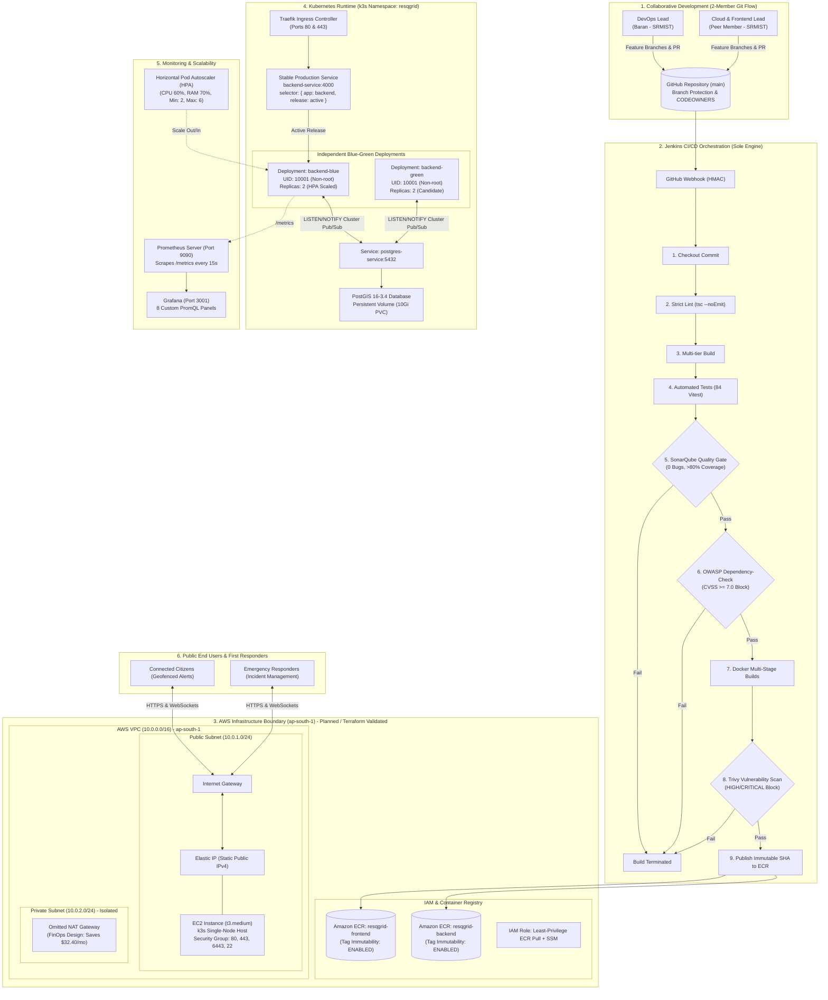

# ResQGrid — Final Technical Architecture & Complete Workflow Model

**Academic Evaluation Context:** SRM Institute of Science and Technology — Final Year B.Tech CSE  
**Phase:** 3 — Comprehensive System Architecture, Cloud Boundaries & Operational Workflows  

---

## 1. Master Architecture & Collaborative Delivery Model

This master diagram depicts the complete end-to-end journey from source code commit by the two team engineers through automated Jenkins verification, security gates, image publication, AWS cloud boundaries, and Kubernetes blue-green execution:



---

## 2. Blue-Green Release Architecture Diagram

This diagram illustrates how candidate releases are deployed alongside active production workloads, validated in isolation, promoted via an atomic selector flip, and rolled back in under 200ms upon failure:

```mermaid
flowchart TD
    subgraph ClientLayer["Client Ingress Layer"]
        TRAFFIC["Production Citizen Traffic"] --> INGRESS["Ingress Controller"]
        INGRESS --> PROD_SVC["Stable Production Service\nbackend-service:4000"]
    end

    subgraph TestingLayer["Candidate Validation Layer"]
        SMOKE_ENGINE["k6 Pre-Promotion Smoke Suite"] --> CAND_SVC["Candidate Test Service\nbackend-candidate-service:4000"]
    end

    subgraph BlueCluster["BLUE Environment (Current Active)"]
        PROD_SVC -->|selector: { release: blue }| BLUE_DEP["backend-blue Deployment\nImage: sha-546cae7\nX-Release-Color: blue\nReplicas: 2"]
    end

    subgraph GreenCluster["GREEN Environment (Candidate Release)"]
        CAND_SVC -->|selector: { release: green }| GREEN_DEP["backend-green Deployment\nImage: sha-candidate\nX-Release-Color: green\nReplicas: 2"]
    end

    subgraph SwitchDecision["Atomic Promotion / Rollback Action"]
        DECISION{"Pre-Promotion Smoke Tests"}
        DECISION -->|PASS| PROMO["Promote Candidate:\nkubectl patch service backend-service\nselector.release = green"]
        DECISION -->|FAIL| ABORT["Halt Promotion:\nProduction remains on BLUE"]
        PROMO --> POST_CHECK{"Post-Switch Verification"}
        POST_CHECK -->|PASS| FINISH["Release Successful! Retain BLUE 30m"]
        POST_CHECK -->|FAIL| ROLLBACK["Execute rollback.sh (177ms):\nselector.release = blue"]
    end

    SMOKE_ENGINE --> DECISION
```

---

## 3. Monitoring & Autoscaling Workflow Diagram

This diagram visualizes the telemetry flow from Node.js process instrumentation through cAdvisor and Prometheus to Grafana, and how CPU/memory consumption drives the Kubernetes HPA scaling loop:

```mermaid
flowchart LR
    subgraph BackendPod["ResQGrid Backend Pod"]
        APP["Express + Socket.IO App"]
        METRICS_ENDPOINT["/metrics (prom-client)"]
        APP --> METRICS_ENDPOINT
    end

    subgraph K8sMetrics["Kubernetes Node Telemetry"]
        CADVISOR["cAdvisor / Kubelet\n(Container CPU & Memory)"]
        METRICS_SERVER["Kubernetes Metrics-Server"]
        CADVISOR --> METRICS_SERVER
    end

    subgraph AutoscalingLoop["Horizontal Pod Autoscaler (HPA)"]
        METRICS_SERVER -->|Reports CPU%| HPA_ENGINE["HPA Controller (autoscaling/v2)\nTarget CPU: 60% | Target RAM: 70%"]
        HPA_ENGINE -->|Evaluates Formula:\ndesired = ceil[current * (metric / 60%)]| SCALE_DECISION{"Scale Decision"}
        SCALE_DECISION -->|CPU > 60%| SCALE_UP["Scale Up (Up to 6 Replicas)\nImmediate reaction (0s window)"]
        SCALE_DECISION -->|CPU < 60%| SCALE_DOWN["Scale Down (Down to 2 Replicas)\nStabilized anti-flapping (300s window)"]
        SCALE_UP & SCALE_DOWN --> BackendPod
    end

    subgraph Observability["Observability Stack"]
        PROM["Prometheus Server\n(Polls /metrics every 15s)"]
        ALERTS["AlertManager Rules\n(Latency > 1.5s, 5xx > 5%)"]
        GRAFANA["Grafana Dashboard\n(8 Real PromQL Metric Panels)"]
        
        METRICS_ENDPOINT -.->|Scraped| PROM
        PROM --> ALERTS
        PROM --> GRAFANA
    end
```

---

## 4. Security Quality Gate & Failure Workflow Diagram

This diagram shows how defective code, vulnerable dependencies, unpatched container layers, and unhealthy releases are intercepted at each distinct stage of delivery:

```mermaid
flowchart TD
    PUSH["Git Push to main"] --> STAGE_TESTS["Stage: Vitest Automated Tests"]
    
    STAGE_TESTS -->|Test Fails| BLOCK_TESTS["HALT: Pipeline Fails (Exit Code 1)\nArtifact not created"]
    STAGE_TESTS -->|Tests Pass (84/84)| STAGE_SONAR["Stage: SonarQube Quality Gate"]

    STAGE_SONAR -->|Bugs / Vulns > 0| BLOCK_SONAR["HALT: Quality Gate Fails\nBuild Aborted"]
    STAGE_SONAR -->|Quality Gate OK| STAGE_OWASP["Stage: OWASP Dependency-Check"]

    STAGE_OWASP -->|CVE with CVSS >= 7.0| BLOCK_OWASP["HALT: High CVE Detected\nBuild Aborted"]
    STAGE_OWASP -->|Dependencies Clean| STAGE_DOCKER["Stage: Build Docker Images"]

    STAGE_DOCKER --> STAGE_TRIVY["Stage: Aqua Trivy Container Scan"]

    STAGE_TRIVY -->|HIGH / CRITICAL CVE Found| BLOCK_TRIVY["HALT: Trivy Exit Code 1\nImage NOT pushed to ECR"]
    STAGE_TRIVY -->|Image Clean (0 CVEs)| STAGE_ECR["Stage: Push Immutable Tag to ECR"]

    STAGE_ECR --> STAGE_CANDIDATE["Stage: Deploy to Candidate Color"]
    STAGE_CANDIDATE --> STAGE_SMOKE{"Stage: Pre-Promotion Smoke Tests"}

    STAGE_SMOKE -->|Checks Fail| BLOCK_PROMO["HALT: Production Selector UNCHANGED\nOld release remains live"]
    STAGE_SMOKE -->|Checks Pass| STAGE_SWITCH["Stage: Switch Production Service"]

    STAGE_SWITCH --> STAGE_VERIFY{"Stage: Post-Switch Live Header Check"}
    STAGE_VERIFY -->|Header Match| SUCCESS["RELEASE CERTIFIED SUCCESSFUL"]
    STAGE_VERIFY -->|Header Mismatch| AUTO_ROLLBACK["AUTOMATIC ROLLBACK TRIGGERED\nRestores Previous Release in 177ms"]
```
