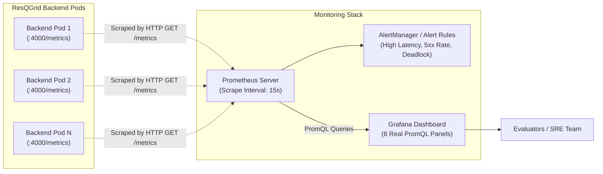

# ResQGrid — Monitoring, Observability & Alerting Guide

**Academic Context:** SRM Institute of Science and Technology — CSE Final Year  
**Phase:** 2 — Observability, Metrics Scraping, PromQL & Alerting  
**Scrape Engine:** Prometheus v2.50+  
**Visualization:** Grafana v10.3+  
**Metrics Instrument:** `prom-client` (Native Node.js Prometheus Client)  

---

## 1. Observability Architecture Overview

ResQGrid implements production-grade white-box observability. The backend natively exports real-time dimensional metrics via the `/metrics` endpoint formatted in the official Prometheus text exposition standard. Prometheus polls this endpoint every 15 seconds, indexes time-series metrics by labels (e.g. `method`, `route`, `status_code`, `provider`, `severity`), and evaluates alerting rules continuously.



---

## 2. Grafana Dashboard Panels & Evaluation Matrix

The dashboard configured in [resqgrid-overview.json](file:///c:/Users/baran/Downloads/Devops_project/infra/monitoring/grafana/dashboards/resqgrid-overview.json) contains **8 real PromQL panels**. Below is the exact PromQL query for each panel and what it demonstrates to project evaluators:

### Panel 1: HTTP Request Throughput (req/sec)
- **PromQL:**
  ```promql
  sum(rate(http_requests_total[1m])) by (method, route)
  ```
- **What it proves during evaluation:**
  Demonstrates live traffic volume and load distribution across individual REST and WebSocket handshake endpoints. Proves the application accurately counts and differentiates between `/api/incidents`, `/api/incidents/nearby`, `/health`, and `/metrics`.

### Panel 2: HTTP Request Latency Quantiles (p50, p95, p99)
- **PromQL:**
  - **Median (p50):** `histogram_quantile(0.50, sum(rate(http_request_duration_seconds_bucket[1m])) by (le))`
  - **95th Percentile (p95):** `histogram_quantile(0.95, sum(rate(http_request_duration_seconds_bucket[1m])) by (le))`
  - **99th Percentile (p99):** `histogram_quantile(0.99, sum(rate(http_request_duration_seconds_bucket[1m])) by (le))`
- **What it proves during evaluation:**
  Validates Service Level Objectives (SLOs). Under baseline load, p95 remains below 200ms. When load testing spikes occur, this panel illustrates the latency tail before and after Kubernetes HPA kicks in to distribute the load.

### Panel 3: HTTP Responses by Status Code
- **PromQL:**
  ```promql
  sum(rate(http_requests_total[1m])) by (status_code)
  ```
- **What it proves during evaluation:**
  Visualizes application reliability. Differentiates successful requests (`200 OK`, `201 Created`) from client input errors (`400 Bad Request`, `404 Not Found`) and backend failures (`500 Internal Server Error`).

### Panel 4: Active Socket.IO Real-Time Clients
- **PromQL:**
  ```promql
  sum(active_socket_connections)
  ```
- **What it proves during evaluation:**
  Tracks the total number of connected first responders and citizens receiving real-time geofenced notifications. Demonstrates that client connections are tracked accurately across multiple pod replicas via the PostgreSQL pub/sub bus.

### Panel 5: Disaster Events Ingested vs Broadcast
- **PromQL:**
  - **Ingested:** `sum(rate(disaster_events_ingested_total[1m])) by (provider, is_simulated)`
  - **Broadcast:** `sum(rate(alerts_broadcast_total[1m])) by (severity)`
- **What it proves during evaluation:**
  Proves end-to-end event streaming from external adapters (USGS, Open-Meteo, manual simulation drills) through to the WebSocket alert broadcast pipeline. Differentiates between real and simulated incidents in compliance with project requirements.

### Panel 6: Application Errors Rate
- **PromQL:**
  ```promql
  sum(rate(application_errors_total[1m])) by (error_type, component)
  ```
- **What it proves during evaluation:**
  Surfaces unhandled exceptions, database query timeouts, or external provider API network disconnects in real time without digging through container log streams.

### Panel 7: Process CPU Core Usage (HPA Trigger Driver)
- **PromQL:**
  ```promql
  rate(process_cpu_user_seconds_total[1m]) + rate(process_cpu_system_seconds_total[1m])
  ```
- **What it proves during evaluation:**
  Shows actual CPU core consumption for Node.js event-loop operations. During k6 stress tests, this panel clearly illustrates CPU rising toward 60%, visually matching the trigger event that causes Kubernetes HPA to add new replicas.

### Panel 8: Node.js Heap Memory & Event Loop Lag
- **PromQL:**
  - **Heap Used:** `nodejs_heap_size_used_bytes`
  - **Heap Total:** `nodejs_heap_size_total_bytes`
  - **Event Loop Lag:** `nodejs_eventloop_lag_seconds`
- **What it proves during evaluation:**
  Proves memory stability (no memory leaks across long-running tests) and Node.js asynchronous event-loop health. If synchronous code blocks the thread, event loop lag spikes above 0.2s, triggering alerts.

---

## 3. Prometheus Alerting Rules

The alert rules defined in [infra/monitoring/prometheus/alerts.yml](file:///c:/Users/baran/Downloads/Devops_project/infra/monitoring/prometheus/alerts.yml) safeguard cluster availability:

| Alert Name | Condition (PromQL) | Duration (`for`) | Severity | Operational Impact |
| :--- | :--- | :--- | :--- | :--- |
| **`ResQGridBackendDown`** | `up{job="resqgrid-backend"} == 0` | 1m | `critical` | Pod crashed or unready; immediate pod investigation required. |
| **`ResQGridHighErrorRate`** | `(5xx_rate / total_rate) * 100 > 5` | 2m | `warning` | API error rate exceeds 5%; points to database issues or invalid payloads. |
| **`ResQGridHighRequestLatency`** | `histogram_quantile(0.95, ...) > 1.5` | 2m | `warning` | Tail latency breached 1.5s; indicates need for pod scaling or query optimization. |
| **`ResQGridEventLoopBlocked`** | `nodejs_eventloop_lag_seconds > 0.2` | 1m | `warning` | Node.js thread blocked by expensive synchronous execution. |
| **`ResQGridHighMemoryUsage`** | `(heap_used / heap_total) * 100 > 85` | 3m | `warning` | Memory saturation; potential memory leak warning before OOMKill. |

---

## 4. How to Run the Monitoring Stack Locally

The monitoring stack can be spun up alongside the application using Docker Compose:

```bash
# Start Prometheus and Grafana
docker compose -f infra/monitoring/docker-compose.monitoring.yml up -d

# Verify containers are healthy
docker compose -f infra/monitoring/docker-compose.monitoring.yml ps
```

- **Prometheus UI:** Accessible at `http://localhost:9090` (Verify targets at `http://localhost:9090/targets`).
- **Grafana UI:** Accessible at `http://localhost:3001` (Credentials: `admin` / `admin`). The ResQGrid Platform Overview dashboard is auto-provisioned upon startup.
