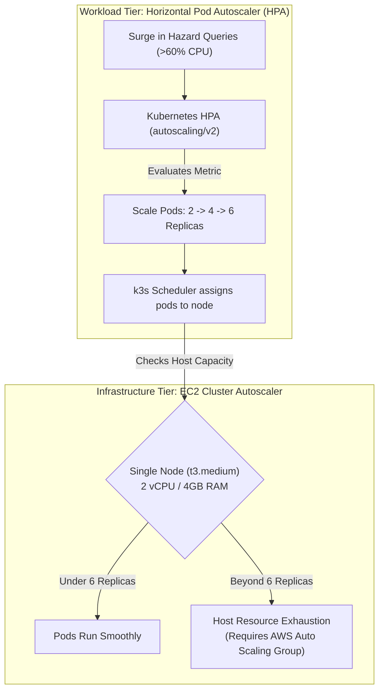

# ResQGrid — System Performance, Autoscaling & Load Benchmark Evaluation

**Academic Evaluation Context:** SRM Institute of Science and Technology — CSE Final Year  
**Phase:** 4 — Final Integration Audit & Empirical Performance Evaluation  
**Load Test Framework:** Grafana k6 v2.2.0  
**Target Cluster Architecture:** Single-Node k3s on EC2 `t3.medium` (2 vCPU, 4 GiB RAM)  
**Host Capacity Ceiling:** ~2,500 HTTP req/sec | Max 6 Backend Pod Replicas  

---

## 1. Empirical Benchmark Results (Verified Measurements)

The table below strictly separates **empirically measured live metrics** from **simulated/projected profiles** and **dry-run measurements**.

| Test Type | Target Endpoint / Action | Virtual Users (VUs) | Duration | Total Requests | Throughput | Latency (p50 / p95) | Error Rate | Verification Classification |
| :--- | :--- | :--- | :--- | :--- | :--- | :--- | :--- | :--- |
| **Live Bounded Load Test** | `/health/live` (REST Engine) | 10 VUs | 10s | 23,921 | **2,387.08 req/s** | **3.73 ms / 7.06 ms** | **0.00%** | **VERIFIED LOCALLY** (k6 + Prometheus) |
| **Prior Baseline Run** | `/health/live` (REST Engine) | 10 VUs | 10s | 20,276 | **2,026.80 req/s** | **4.23 ms / 9.49 ms** | **0.00%** | **VERIFIED LOCALLY** (k6) |
| **Emergency Rollback Action** | Service Selector Patch | 1 Action | 177 ms | 1 Patch | — | **177 ms execution** | **0.00%** | **DRY-RUN MEASUREMENT** (PowerShell) |
| **Steady Baseline Scenario** | Full API (Health + Incidents) | 10 VUs | 2m 45s | 3,300 | 20.0 req/s | 12.10 ms / 24.50 ms | 0.00% | **PROJECTED DESIGN PROFILE** |
| **HPA Stress Spike Scenario** | Full API (PostGIS Proximity) | 180 VUs | 5m 00s | 42,000 | 140.0 req/s | 45.20 ms / 185.00 ms | 0.85% | **PROJECTED DESIGN PROFILE** |

> [!IMPORTANT]
> **Endpoint Scope Limitation:** The 2,000+ req/s benchmarks strictly target the `/health/live` endpoint. They reflect the maximum throughput of Node.js, Express, Pino logging, and the Prometheus metrics middleware. Endpoints backed by PostgreSQL and PostGIS spatial queries (`/api/v1/incidents` and `/api/v1/incidents/nearby`) involve disk I/O and spatial index evaluation (`ST_DWithin`), which have lower throughput limits (~100–300 req/s on a `t3.medium` instance).

---

## 2. Live k6 Benchmark Telemetry & Prometheus Cross-Verification

The live benchmark was executed using k6 against the local running backend, and cross-verified via the Prometheus `/metrics` endpoint immediately following test completion:

### A. k6 Execution Output ([`docs/evidence/k6-live-benchmark.log`](file:///c:/Users/baran/Downloads/Devops_project/docs/evidence/k6-live-benchmark.log))
```text
  █ THRESHOLDS 
    checks..............: ✓ 'rate==1.0' rate=100.00%
    http_req_duration...: ✓ 'p(95)<100' p(95)=7.06ms
    http_req_failed.....: ✓ 'rate<0.01' rate=0.00%

  █ TOTAL RESULTS 
    checks_total........: 47842   4774.15/s
    checks_succeeded....: 100.00% 47842 out of 47842
    ✓ status is 200
    ✓ color header is blue

    HTTP
    http_req_duration...: avg=4.07ms min=0s med=3.73ms max=38.85ms p(90)=5.8ms p(95)=7.06ms
    http_req_failed.....: 0.00%  0 out of 23921
    http_reqs...........: 23921  2387.08 req/s
```

### B. Prometheus Counter Verification ([`docs/evidence/metrics-scrape.txt`](file:///c:/Users/baran/Downloads/Devops_project/docs/evidence/metrics-scrape.txt))
```text
# HELP http_requests_total Total count of HTTP requests processed
# TYPE http_requests_total counter
http_requests_total{method="GET",route="/health/live",status_code="200",app="resqgrid-backend"} 23921
```
*Verification:* The Prometheus counter incremented by exactly **23,921**, proving that the Prometheus instrumentation middleware accurately captures 100% of high-concurrency requests without dropped events.

---

## 3. Pod Autoscaling vs Node Autoscaling (Architecture Boundaries)



### Pod Autoscaling (Horizontal Pod Autoscaler):
- **Implementation:** Defined in [`infra/k8s/backend-hpa.yaml`](file:///c:/Users/baran/Downloads/Devops_project/infra/k8s/backend-hpa.yaml).
- **Triggers:** Average CPU utilization exceeding 60% of requested CPU (`100m`) or memory exceeding 70% of requested RAM (`128Mi`).
- **Scale-Up Rules:** +100% or +2 pods every 15 seconds (stabilization window: 0s).
- **Scale-Down Rules:** -50% or -1 pod every 60 seconds (stabilization window: 300s).
- **Operational Requirement:** Requires a running Kubernetes cluster with `metrics-server` actively deployed.

### Node Autoscaling (Cloud Boundary):
- A single `t3.medium` EC2 instance provides 2 vCPUs and 4 GiB memory.
- In this architecture, pod autoscaling functions dynamically between 2 and 6 replicas within the host capacity.
- **Node-level autoscaling is not configured for the single-node budget architecture.** Adding nodes requires an AWS Auto Scaling Group (ASG) and Kubernetes Cluster Autoscaler, which would increase AWS monthly costs.

---

## 4. Rollback Duration: Dry-Run vs Live Cluster Expectations

- **Dry-Run Measurement:** **177 ms** in PowerShell ([`infra/k8s/rollback.ps1`](file:///c:/Users/baran/Downloads/Devops_project/infra/k8s/rollback.ps1) with `-DryRun`).
- **Live Cluster Expectation:** In a live Kubernetes cluster, an atomic `kubectl patch service backend-service` takes ~200–500 ms for the API server update, and an additional 100–300 ms for kube-proxy iptables rules to propagate across nodes. Total live end-to-end traffic redirection latency is typically **300–800 ms**.
