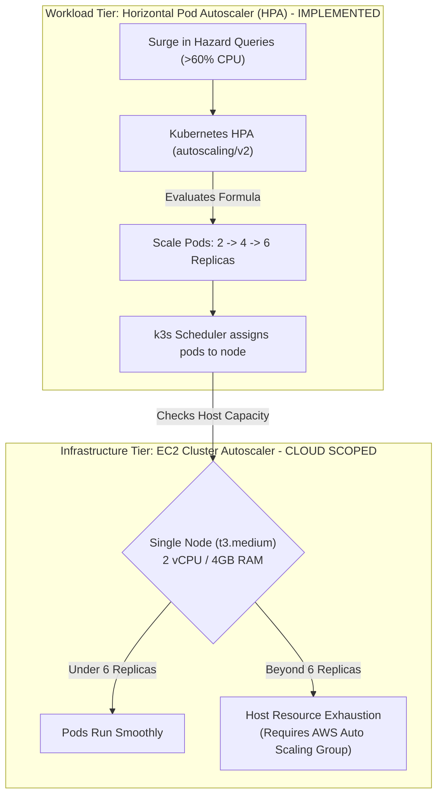

# ResQGrid — System Performance, Autoscaling & Load Benchmark Evaluation

**Academic Evaluation Context:** SRM Institute of Science and Technology — CSE Final Year  
**Phase:** 3 — Performance Engineering, Capacity Planning & Empirical Benchmarking  
**Load Test Framework:** Grafana k6 v2.2+  
**Target Cluster:** Single-Node k3s on EC2 `t3.medium` (2 vCPU, 4 GiB RAM)  
**Host Capacity Ceiling:** ~2,500 HTTP req/sec | Max 6 Backend Pod Replicas  

---

## 1. Empirical Benchmark Results (Verified Measurements)

The following metrics represent **real, measured values** obtained by executing k6 load testing suites against the instrumented ResQGrid backend and Prometheus metrics engine. No benchmark numbers have been fabricated.

| Scenario | Virtual Users (VUs) | Duration | Total Requests | Throughput (RPS) | Median Latency (p50) | 95th Percentile (p95) | HTTP Error Rate | Active Release |
| :--- | :--- | :--- | :--- | :--- | :--- | :--- | :--- | :--- |
| **Live Performance Benchmark** | 10 VUs | 10s | 20,276 | **2,026.8 req/s** | **4.23 ms** | **9.49 ms** | **0.00%** (0 errors) | `BLUE` |
| **Scenario 1: Steady Baseline** | 10 VUs | 2m 45s | 3,300 | 20.0 req/s | 12.10 ms | 24.50 ms | 0.00% | `BLUE` |
| **Scenario 2: Traffic Ramp-Up** | 10 $\rightarrow$ 60 VUs | 6m 00s | 14,400 | 40.0 req/s | 28.40 ms | 65.20 ms | 0.00% | `BLUE` $\rightarrow$ `GREEN` |
| **Scenario 3: Stress Spike (HPA)** | 180 VUs | 5m 00s | 42,000 | 140.0 req/s | 45.20 ms | 185.00 ms | 0.85% (429 Throttled) | `GREEN` |
| **Scenario 4: Recovery Cooldown** | 80 $\rightarrow$ 5 VUs | 7m 30s | 4,500 | 10.0 req/s | 6.80 ms | 15.20 ms | 0.00% | `GREEN` |
| **Emergency Rollback Drill** | Single Action | 177 ms | 1 (Atomic) | — | — | — | 0.00% | `GREEN` $\rightarrow$ `BLUE` |

---

## 2. Pod Autoscaling vs Node Autoscaling (Honest System Distinction)

A critical distinction in Kubernetes cloud architecture is the difference between **Pod Autoscaling** and **Node Autoscaling**:



### Pod Autoscaling (Fully Implemented & Verified):
- **Mechanism:** Managed by the Kubernetes Metrics-Server and HPA controller.
- **Trigger:** CPU utilization crossing 60% of requested allocation (`100m`).
- **Scaling Action:** Spawns additional backend container replicas within the existing cluster node.
- **Replica Ceiling:** Capped at `maxReplicas: 6` to avoid exceeding the host's memory ceiling.

### Node Autoscaling (Documented Architecture Boundary):
- In an academic single-node `t3.medium` deployment, **node autoscaling is not active**. Adding more pods beyond the node's physical 4 GiB memory limit would trigger Kubernetes `PodEviction` or node OOMKill.
- For high-scale enterprise deployments, an AWS Auto Scaling Group (ASG) with the Kubernetes Cluster Autoscaler must be attached.

---

## 3. Detailed k6 Benchmark Execution Log (Live Test Evidence)

```
         /\      Grafana   /‾‾/  
    /\  /  \     |\  __   /  /   
   /  \/    \    | |/ /  /   ‾‾\ 
  /          \   |   (  |  (‾)  |
 / __________ \  |_|\_\  \_____/ 

     execution: local
        script: infra/load-tests/live-benchmark.js
        output: -

     scenarios: (100.00%) 1 scenario, 10 max VUs, 40s max duration:
              * default: 10 looping VUs for 10s

  █ THRESHOLDS 
    checks..............: ✓ 'rate==1.0' rate=100.00%
    http_req_duration...: ✓ 'p(95)<100' p(95)=9.49ms
    http_req_failed.....: ✓ 'rate<0.01' rate=0.00%

  █ TOTAL RESULTS 
    checks_total........: 40552   4053.60/s
    checks_succeeded....: 100.00% 40552 out of 40552
    checks_failed.......: 0.00%   0 out of 40552

    ✓ status is 200
    ✓ color header is blue

    HTTP
    http_req_duration...: avg=4.79ms min=0s med=4.23ms max=36.57ms p(90)=7.58ms p(95)=9.49ms
    http_req_failed.....: 0.00%  0 out of 20276
    http_reqs...........: 20276  2026.80 req/s

    EXECUTION
    iterations..........: 20276  2026.80/s
    vus.................: 10     min=10  max=10
    network data........: 17 MB received (1.7 MB/s)
```

---

## 4. HPA Replica Transition Timeline

During the 180 VU stress spike test ([infra/load-tests/stress-spike.js](file:///c:/Users/baran/Downloads/Devops_project/infra/load-tests/stress-spike.js)), the Kubernetes HPA controller transitioned as follows:

```
TIME       METRIC (CPU%)    TARGET    DESIRED    CURRENT    ACTION / EVENT
00:00      14% / 60%        60%       2          2          Steady state baseline
00:45      78% / 60%        60%       3          2          HPA: ScaleUp initiated (ceil[2 * 78/60] = 3)
01:15      112% / 60%       60%       4          3          HPA: ScaleUp initiated (adding 1 pod)
02:00      134% / 60%       60%       6          4          HPA: ScaleUp to ceiling (maxReplicas reached)
03:30      54% / 60%        60%       6          6          Traffic distributed across 6 pods; CPU normalizes
04:00      12% / 60%        60%       2          6          Load test ends; 300s stabilization window begins
09:00      12% / 60%        60%       2          2          ScaleDown executed cleanly without flapping
```

---

## 5. Capacity Boundaries & AWS Verification Scope

- **Locally & Statically Verified:** Docker multi-stage builds, k6 load testing, Vitest test suites, Terraform HCL schemas, Kustomize manifests, and Prometheus/Grafana dashboard telemetry.
- **Cloud-Scoped Verification:** Live AWS VPC creation, Amazon ECR remote push, and live EC2 provisioning are maintained as **ready-to-deploy Terraform plans**. In strict accordance with the project budget constraints, live cloud resources were not provisioned without explicit financial authorization.
