# ResQGrid — Security & Vulnerability Management Policy

**Academic Context:** SRM Institute of Science and Technology — CSE Final Year  
**Phase:** 2 — Security Scanning, Static Analysis & Container Hardening  

---

## 1. Security Philosophy: Defense in Depth & Shift-Left

ResQGrid implements a defense-in-depth security model across the entire software delivery lifecycle. Rather than treating security as an afterthought or post-deployment audit, automated security verification gates are injected into the earliest possible phases of development and CI/CD automation.

```mermaid
flowchart LR
    subgraph DevTime["1. Development"]
        LINT["Strict TypeScript\n(tsc --noEmit)"]
        GITIGNORE[".gitignore Exclusions\n(No Secrets Committed)"]
    end

    subgraph CITime["2. Pipeline Security Gates"]
        SONAR["SonarQube Quality Gate\n(0 Vulnerabilities)"]
        OWASP["OWASP Dependency-Check\n(CVSS >= 7.0 Block)"]
        TRIVY["Trivy Container Scan\n(HIGH/CRITICAL Block)"]
    end

    subgraph RegistryTime["3. Registry Security"]
        ECR_SCAN["ECR Scan-on-Push"]
        IMMUTABLE["Tag Immutability"]
    end

    subgraph RunTime["4. Kubernetes Runtime Security"]
        NONROOT["Non-Root UID 10001"]
        RO_FS["Read-Only Root Filesystem"]
        DROP_CAPS["Drop ALL Capabilities"]
        ISOLATION["Private DB Subnet SG"]
    end

    DevTime --> CITime --> RegistryTime --> RunTime
```



---

## 2. Multi-Tier Security Scanner Specifications

### A. Static Application Security Testing (SAST) — SonarQube
- **Scanner:** SonarScanner CLI
- **Configuration:** [sonar-project.properties](file:///c:/Users/baran/Downloads/Devops_project/sonar-project.properties)
- **Quality Gate Criteria:**
  - **New Bugs:** 0
  - **New Vulnerabilities:** 0
  - **New Security Hotspots:** 0 (all must be reviewed and marked safe)
  - **Code Coverage on New Code:** ≥ 80.0%
  - **Duplicated Lines Density:** < 3.0%
  - **Maintainability Rating:** A
  - **Reliability Rating:** A
  - **Security Rating:** A

### B. Software Composition Analysis (SCA) — OWASP Dependency-Check
- **Scanner:** OWASP Dependency-Check v9.0+
- **Database:** Synchronized with the National Vulnerability Database (NVD).
- **Suppression Management:** Documented in [dependency-check-suppressions.xml](file:///c:/Users/baran/Downloads/Devops_project/dependency-check-suppressions.xml).
- **Enforcement Thresholds:**
  - **Low / Medium (CVSS 0.0 - 6.9):** Build logs a security advisory for triage in the subsequent sprint.
  - **High / Critical (CVSS ≥ 7.0):** **Hard failure**. Pipeline terminates immediately with exit code `1`. No container build is initiated.

### C. Container Image Vulnerability Scanning — Aqua Trivy
- **Scanner:** Aqua Trivy v0.50+
- **Scan Targets:** Built Docker images (`resqgrid-backend` and `resqgrid-frontend`).
- **Policy Flags:**
  ```bash
  trivy image \
    --severity HIGH,CRITICAL \
    --exit-code 1 \
    --ignore-unfixed \
    --format table \
    ${IMAGE_NAME}
  ```
- **Enforcement Rule:** If any unpatched HIGH or CRITICAL vulnerability is detected in either base OS packages or application dependencies, the build is aborted.

---

## 3. Container Runtime Hardening

Both application containers are structured with non-root security contexts in Kubernetes ([infra/k8s/backend-deployment.yaml](file:///c:/Users/baran/Downloads/Devops_project/infra/k8s/backend-deployment.yaml)):

```yaml
securityContext:
  runAsNonRoot: true
  runAsUser: 10001
  runAsGroup: 10001
  fsGroup: 10001
containers:
  - name: backend
    securityContext:
      allowPrivilegeEscalation: false
      readOnlyRootFilesystem: true
      capabilities:
        drop:
          - ALL
    volumeMounts:
      - name: tmp-volume
        mountPath: /tmp
```

### Security Benefits
1. **`runAsNonRoot: true` & `runAsUser: 10001`:** If an attacker manages to execute remote code inside the container, they cannot access root-level host files or compromise the host kernel.
2. **`allowPrivilegeEscalation: false`:** Prevents child processes from gaining more privileges than their parent process (blocks `setuid` exploits).
3. **`readOnlyRootFilesystem: true`:** Prevents malware from downloading or altering binaries or script files in `/app` or `/bin`.
4. **`capabilities: drop: ["ALL"]`:** Disables all Linux kernel capabilities (e.g. `CAP_NET_RAW`, `CAP_SYS_ADMIN`), restricting the process to standard userland memory operations.

---

## 4. Secret Management & Sensitive Data Handling

- **Exclusion from VCS:** All `.env`, `*.key`, `.pem`, and credential files are explicitly excluded via [.gitignore](file:///c:/Users/baran/Downloads/Devops_project/.gitignore).
- **Template Declarations:** Sample configurations are distributed exclusively via `.env.example` and `terraform.tfvars.example`.
- **Runtime Injection:** Secrets (`DB_PASSWORD`, `JWT_SECRET`) are mounted dynamically into Kubernetes pods from Kubernetes Secret objects (`resqgrid-secrets`), keeping credentials decoupled from source code and Docker image layers.
- **Production Key Management:** In production deployments, secrets are integrated with AWS Secrets Manager or HashiCorp Vault via the External Secrets Operator.

---

## 5. Vulnerability Triage & Remediation Workflow

When a vulnerability is flagged during continuous integration:
1. **Identify CVSS Severity:** Determine whether the finding is a true positive or a known dev-dependency false alarm.
2. **Update Package:** If an updated upstream version exists, update `package.json` and execute `npm update <package>` followed by `npm test`.
3. **Formal Suppression (If Unfixable False Positive):** If a vulnerability is confirmed to be an inapplicable false positive (e.g., a CLI tool issue not exposed in production runtime), document the rationale in [dependency-check-suppressions.xml](file:///c:/Users/baran/Downloads/Devops_project/dependency-check-suppressions.xml) with CVE ID, rationale, and expiration date.
